# Saletse: documentación del proyecto

**Corte:** 2026-10-18, sobre `main` en `72a3ca4` (el SHA de la API en producción).
**Alcance:** documento de entrada al proyecto. Describe qué es el producto, cómo está construido, cómo funcionan los flujos principales, cómo se prueba y se despliega, y qué cambió en la semana del 11 al 18 de octubre de 2026.
**Fuente:** el código y los documentos del repo en ese SHA. Si un documento enlazado contradice al código, manda el código. Lo que no se pudo verificar en el repo está marcado como **por confirmar**.

> Este repositorio es **público**. Aquí no hay direcciones de servidores, rutas de backups, credenciales, cuentas, nombres de políticas de base de datos ni detalles de hallazgos de seguridad. Todo eso vive en un apéndice privado de operaciones, fuera del repo, que mantiene el operador.

## Índice

1. [Resumen del producto](#1-resumen-del-producto)
2. [Tecnologías y versiones](#2-tecnologías-y-versiones)
3. [Estructura del repositorio](#3-estructura-del-repositorio)
4. [Arquitectura](#4-arquitectura)
5. [Contratos que no se renombran](#5-contratos-que-no-se-renombran)
6. [Modelo de datos](#6-modelo-de-datos)
7. [Funcionamiento y flujos](#7-funcionamiento-y-flujos)
8. [Internacionalización y PWA](#8-internacionalización-y-pwa)
9. [Pruebas y calidad](#9-pruebas-y-calidad)
10. [Entornos y despliegue](#10-entornos-y-despliegue)
11. [Cambios de la semana (11–18 oct 2026)](#11-cambios-de-la-semana-1118-oct-2026)
12. [Deuda técnica y backlog](#12-deuda-técnica-y-backlog)
13. [Guía de onboarding](#13-guía-de-onboarding)
14. [Glosario y mapa de documentos](#14-glosario-y-mapa-de-documentos)
15. [Cómo mantener este documento](#15-cómo-mantener-este-documento)

---

## 1. Resumen del producto

Saletse es un SaaS de ventas para **equipos de ventas de tiempo compartido y clubes vacacionales**. Cubre el día a día de una sala de ventas: la agenda del vendedor, los expedientes de cada pareja o prospecto, las calculadoras de cierre, las metas, las ventas, los mensajes y las notificaciones. Funciona como PWA *offline-first*: el vendedor trabaja con datos locales y la app sincroniza con la nube cuando hay conexión ([`README.md`](../README.md), [`MAPA-GENERAL-SISTEMA.md`](./MAPA-GENERAL-SISTEMA.md)).

Es **multi-workspace**: cada usuario tiene un workspace **personal** y puede pertenecer a una o varias **salas de ventas** de una empresa (tenant). La jerarquía es plataforma → empresa → sala ([`JERARQUIA-WORKSPACES-ENTREGABLE.md`](./JERARQUIA-WORKSPACES-ENTREGABLE.md)).

### Módulos funcionales

| Módulo | Qué hace para el usuario | Ruta UI principal |
|--------|--------------------------|-------------------|
| Agenda | Calendario del vendedor: ventas, notas, *follow-ups*, descansos | `/` |
| Expedientes (clientes) | Ficha de cada prospecto, con pestañas por herramienta, participantes y colaboración en tiempo real | `/clients`, `/clients/:id` |
| Herramientas | Survey, Proyección de vacaciones, Worksheet y Money Box, libres o dentro del expediente | `/tools`, `/clients/:id/<herramienta>` |
| Metas | Objetivos mensuales (volumen, tours, ventas, días, descansos) y tablero de KPIs | `/goals`, `/metas` |
| Ventas | Historial de ventas | `/sales` |
| Red y mensajes | Contactos, solicitudes de conexión y mensajes directos | `/network`, `/messages` |
| Equipo | Vista de gerente | `/team` |
| Royal Holiday | Worksheet RH, Money Box RH, Premanifiesto, Flyback y herramientas de operación de sala | `/tools/rh/*`, `/ops/rh/*` |
| Administración | Usuarios, roles, módulos, empresas, logs, soporte | `/admin/*` |
| Configuración | Idioma, moneda, tipo de cambio, notificaciones | `/settings` |

Las rutas están en [`apps/web/src/routes/index.jsx`](../apps/web/src/routes/index.jsx) y [`apps/web/src/routes/lazy-pages.js`](../apps/web/src/routes/lazy-pages.js).

### Roles de usuario

Hay dos dimensiones distintas: los **flags y paquetes** deciden qué módulos y herramientas aparecen, y los **permisos de acción** (`permission_keys`) deciden qué puede hacer la API. El detalle vigente está en [`ROLES-Y-PERMISOS.md`](./ROLES-Y-PERMISOS.md).

| Rol / puesto | Qué hace |
|--------------|----------|
| Liner | Vendedor de sala. Survey y Vacaciones; crea y edita **sus** expedientes; no ve al equipo |
| Cerrador | Cierra ventas. Worksheet y Money Box; permiso de cierre del workflow |
| Gerente | Ve al equipo (expedientes, ventas, dashboard, metas), revisa el workflow y asigna cerrador |
| Marketing / OPC | Puestos de Royal Holiday: registrar o invitar parejas en el Premanifiesto |
| Rep, Ops, CSI | No son puestos: son flags de Royal Holiday encima de otro puesto (tomar caso, hub de operación, notas CSI) |
| Asistente de sala / de empresa | Sin permisos propios del catálogo; trabajan solo por delegación |
| Admin de empresa | Bandera de membresía de empresa (no es un puesto de sala): catálogo, puestos y marca de su empresa |
| Admin de plataforma / Superadmin / Soporte | Roles de plataforma: administración, catálogo completo y tickets de soporte |

Por confirmar (según [`ROLES-Y-PERMISOS.md`](./ROLES-Y-PERMISOS.md) §7): si Soporte ve el panel Admin sin ser admin, y qué flags recibe un asistente recién creado.

---

## 2. Tecnologías y versiones

Monorepo con **npm workspaces** (`apps/*`, `packages/*`), declarado en [`package.json`](../package.json). La tabla muestra el rango declarado en el `package.json` de cada workspace y la versión resuelta en [`package-lock.json`](../package-lock.json).

<!-- versiones:inicio -->
| Paquete | Declarado | Resuelto (lock) | Workspace |
|---------|-----------|-----------------|-----------|
| react | ^19.2.7 | 19.2.7 | apps/web |
| react-dom | ^19.2.7 | 19.2.7 | apps/web |
| react-router-dom | ^7.6.2 | 7.18.2 | apps/web |
| zustand | ^5.0.14 | 5.0.14 | apps/web |
| vite | ^6.3.5 | 6.4.3 | apps/web |
| vite-plugin-pwa | ^1.0.0 | 1.3.0 | apps/web |
| tailwindcss | ^3.4.1 | 3.4.19 | apps/web |
| @supabase/ssr | ^0.10.3 | 0.10.3 | apps/web |
| @sentry/browser | ^9.47.1 | 9.47.1 | apps/web |
| recharts | ^3.8.1 | 3.8.1 | apps/web |
| @base-ui/react | ^1.5.0 | 1.5.0 | apps/web |
| lucide-react | ^1.17.0 | 1.17.0 | apps/web |
| express | ^4.21.2 | 4.22.3 | apps/api |
| @supabase/supabase-js | ^2.107.0 | 2.107.0 | apps/api |
| helmet | ^7.2.0 | 7.2.0 | apps/api |
| ws | ^8.21.3 | 8.21.3 | apps/api |
| resend | ^6.17.2 | 6.17.2 | apps/api |
| compression | ^1.8.2 | 1.8.2 | apps/api |
| cors | ^2.8.5 | 2.8.6 | apps/api |
| cookie-parser | ^1.4.7 | 1.4.7 | apps/api |
| @playwright/test | ^1.52.0 | 1.60.0 | raíz |
| typescript | ^5 | 5.9.3 | raíz |
<!-- versiones:fin -->

| Pieza | Uso | Versión |
|-------|-----|---------|
| Node.js | Runtime de la API, del build y de los scripts | CI usa **20** (`.github/workflows/*.yml`). No hay `engines` declarado; versión de producción **por confirmar** |
| Supabase | Postgres, Auth (GoTrue), Realtime (Presence, Broadcast, Postgres Changes) y PostgREST | Autoalojado; versión **por confirmar** |
| Nginx | Sirve el SPA, hace de proxy de `/api`, `/auth` y `/health`, cabeceras de seguridad y rate limit | Plantillas en [`deploy/`](../deploy/); versión **por confirmar** |
| PM2 | Proceso de la API | Config en [`deploy/ecosystem.config.cjs`](../deploy/ecosystem.config.cjs); versión **por confirmar** |
| OneSignal | Push web en móvil | SDK servido desde [`public/onesignal/`](../public/onesignal/); versión **por confirmar** |
| Workbox | Service worker de la PWA (vía `vite-plugin-pwa`) | Lo resuelve el lock |
| Frankfurter | Proveedor externo del tipo de cambio | Lo usa [`apps/api/src/modulos/geo-fx/`](../apps/api/src/modulos/geo-fx/) |
| Resend | Correo de soporte | Dependencia de la API |
| Sentry | Errores en el navegador (opcional) | `@sentry/browser` |

Nota: [`README.md`](../README.md) aún dice "deploy en Vercel" y el repo conserva [`vercel.json`](../vercel.json) y [`api/index.mjs`](../api/index.mjs). La producción actual es un servidor propio con Nginx, PM2 y Supabase autoalojado ([`arquitectura/entornos.md`](./arquitectura/entornos.md)). Si Vercel sigue en uso para algo: **por confirmar**.

---

## 3. Estructura del repositorio

```text
sales-app/
├── apps/
│   ├── web/                  # SPA Vite + React (PWA)
│   │   ├── index.html
│   │   ├── vite.config.js    # alias @/, proxy /api y /auth en dev, PWA/Workbox
│   │   └── src/
│   │       ├── modulos/      # módulos verticales migrados (código nuevo va aquí)
│   │       ├── components/   # UI legacy por dominio (congelado)
│   │       ├── lib/          # lógica y clientes legacy (congelado)
│   │       ├── pages/ hooks/ actions/ stores/   # congelados
│   │       ├── layouts/ routes/ styles/
│   │       ├── App.jsx
│   │       └── main.jsx
│   └── api/                  # Express (ESM)
│       └── src/
│           ├── modulos/      # módulos verticales migrados
│           ├── routes/ controllers/ services/ repositories/ lib/   # congelados
│           ├── middleware/   # auth, rate limit
│           ├── app.js        # Express, Helmet, /health, montaje de /auth y /api/v1
│           └── index.js      # arranque
├── packages/shared/src/      # dominio compartido: auth/permisos, data/sync, push, cálculos, formato
├── supabase/migrations/      # SQL numerado 0001…0098 (97 archivos; hueco histórico 0024)
├── e2e/                      # Playwright (specs + helpers con semilla local y mocks)
├── scripts/                  # utilidades, smokes, seeds; scripts/architecture/ = checks de CI
├── docs/                     # documentación; docs/arquitectura/ = decisiones, cortes, planes de deploy
├── deploy/                   # plantillas Nginx y PM2
├── public/                   # assets estáticos compartidos (boot.js, iconos, SW de OneSignal)
├── .github/workflows/        # Arquitectura, E2E y Migrate
└── .cursor/rules/            # reglas para agentes (BD de producción, higiene de scripts)
```

Conteo de archivos versionados tras el Tramo C de notificaciones (API en `modulos/`; web sin cambio respecto al Tramo A):

| Carpeta | Archivos | Carpeta | Archivos |
|---------|---------:|---------|---------:|
| `apps/web/src/modulos` | 77 | `apps/api/src/modulos` | 42 |
| `apps/web/src/lib` | 131 | `apps/api/src/services` | 34 |
| `apps/web/src/components` | 98 | `apps/api/src/lib` | 28 |
| `apps/web/src/pages` | 30 | `apps/api/src/routes` | 22 |
| `apps/web/src/hooks` | 26 | `apps/api/src/controllers` | 19 |
| `apps/web/src/actions` | 4 | `apps/api/src/repositories` | 4 |
| `apps/web/src/stores` | 3 | `apps/api/src/middleware` | 4 |
| `apps/web/src/layouts` + `routes` + `styles` | 8 | `packages/shared/src` | 20 |
| `supabase/migrations` | 97 | `e2e` | 16 |
| `scripts` | 140 | `docs` | 92 |

### Convenciones de nombres

- **Código propio nuevo en español**: carpetas internas de módulo (`dominio/`, `servicios/`, `rutas/`, `controladores/`, `repositorio/`), funciones y archivos (`calculo-vacaciones.ts`, `listarMetas`). Los términos técnicos (`middleware`, `request`, `controller`) se quedan en inglés ([`ARQUITECTURA-API.md`](./ARQUITECTURA-API.md)).
- **Marcas de producto** sin traducir en la UI: Survey, Worksheet, Money Box, Royal Holiday ([`arquitectura/decisiones.md`](./arquitectura/decisiones.md) §3).
- **Contratos en inglés técnico estable**, que no se renombran: tablas y columnas, rutas HTTP, claves `sts4_*` y claves de settings ([`arquitectura/glosario.md`](./arquitectura/glosario.md)). Ante la duda, no se renombra y se pregunta. Ver la [sección 5](#5-contratos-que-no-se-renombran).
- Migraciones: `supabase/migrations/NNNN_descripcion.sql` con número correlativo de 4 dígitos.

---

## 4. Arquitectura

### 4.1 Vista general

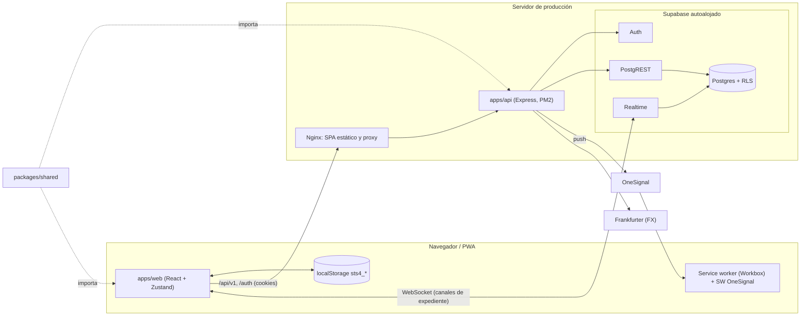

### 4.2 Capas de la API

Fijadas en [`ARQUITECTURA-API.md`](./ARQUITECTURA-API.md):

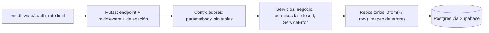

- El agregador es [`apps/api/src/routes/v1.js`](../apps/api/src/routes/v1.js): monta todos los routers bajo `/api/v1` y publica el catálogo con `GET /api/v1`. `/auth` (login con cookies) se monta en [`apps/api/src/app.js`](../apps/api/src/app.js), fuera de `/api/v1`.
- El envelope `{ data }` / `{ error }` lo aplica `runService` ([`apps/api/src/routes/route-utils.js`](../apps/api/src/routes/route-utils.js)).
- La autorización por workspace (`requireWorkspacePermission`, `requireWorkspaceFlag`) vive en [`apps/api/src/lib/workspace-scope.js`](../apps/api/src/lib/workspace-scope.js) y es *fail-closed*. En los módulos densos (Royal Holiday, sync, flags) las consultas siguen dentro del servicio.

### 4.3 Módulos verticales

Decisión de arquitectura **A + B** ([`arquitectura/decisiones.md`](./arquitectura/decisiones.md) §1): cada módulo es una carpeta vertical con MVC interno. Antes de mover nada se extrae el dominio puro con pruebas (B) y después se mueve a `modulos/<nombre>/` (A).

```text
apps/web/src/modulos/<nombre>/
  index.ts | index.js | fachada-node.js   # fachada pública (obligatoria)
  dominio/      # puro, sin I/O, con tests
  servicios/    # orquestación / adaptadores
  ui/ api/ hooks/ i18n/ captura/ …         # según necesidad

apps/api/src/modulos/<nombre>/
  index.js      # fachada (exporta routers y funciones públicas)
  dominio/ servicios/ repositorio/ controladores/ rutas/
```

**Fachadas** ([`arquitectura/contencion-y-fachadas.md`](./arquitectura/contencion-y-fachadas.md)): desde fuera de un módulo, u otro módulo, solo se importa su fachada (`@/modulos/<nombre>` en web, `../modulos/<nombre>/index.js` en API), nunca `dominio/` ni `servicios/`. En web la fachada es `index.ts` (o `index.js` si el módulo es solo JS). `fachada-node.js` existe solo para código web que se carga con `node` sin bundler: no puede llamarse `index.js`, porque Vite prioriza `index.js` sobre `index.ts` y rompe el build. Las entradas delgadas permitidas (`fachada-i18n.js`, `fachada-preguntas.js`, `fachada-toast.js`) evitan que un import pequeño arrastre la UI completa del módulo.

**Contención legacy**: las carpetas congeladas (web: `components`, `lib`, `pages`, `hooks`, `actions`, `stores`; API: `routes`, `controllers`, `services`, `repositories`, `lib`) no pueden recibir archivos nuevos. La lista base está en [`scripts/architecture/legacy-baseline.json`](../scripts/architecture/legacy-baseline.json) (403 archivos) y **solo puede encoger**. Las excepciones justificadas van en [`scripts/architecture/legacy-containment-exceptions.json`](../scripts/architecture/legacy-containment-exceptions.json) (3 en este corte).

**Reglas de dependencia**: los componentes no hacen `fetch` directo fuera de la allowlist [`scripts/architecture/allowlist-component-fetch.json`](../scripts/architecture/allowlist-component-fetch.json); los imports cruzados entre módulos van por fachada; `packages/shared` no importa de `apps/`.

### 4.4 Checks de arquitectura

`npm run verificar:arquitectura:checks` (corre en CI) encadena:

| Check | Qué protege |
|-------|-------------|
| [`check-layer-boundaries.mjs`](../scripts/architecture/check-layer-boundaries.mjs) | `fetch(` en componentes fuera de la allowlist e imports prohibidos entre capas |
| [`check-lazy-imports.mjs`](../scripts/architecture/check-lazy-imports.mjs) | Instantánea de los `import()` lazy (rutas, expediente, prefetch del sidebar) |
| [`check-tool-contracts.mjs`](../scripts/architecture/check-tool-contracts.mjs) | Forma de `tool_calculations.data` y de la config de Money Box contra los fixtures de [`scripts/architecture/fixtures/tool-data/`](../scripts/architecture/fixtures/tool-data/) |
| [`check-push-deeplinks.mjs`](../scripts/architecture/check-push-deeplinks.mjs) | Que cada `PushType` tenga deep link a una ruta existente |
| [`check-shared-parity.mjs`](../scripts/architecture/check-shared-parity.mjs) | Paridad web ↔ shared de los archivos de [`scripts/architecture/sync-shared-files.json`](../scripts/architecture/sync-shared-files.json) |
| [`check-legacy-containment.mjs`](../scripts/architecture/check-legacy-containment.mjs) | Que no haya archivos nuevos en carpetas congeladas |
| [`check-module-facades.mjs`](../scripts/architecture/check-module-facades.mjs) | Que no haya imports a internos de otro módulo |
| [`e2e-comparar-baseline.test.mjs`](../scripts/architecture/e2e-comparar-baseline.test.mjs) | Tests del comparador de resultados E2E contra la baseline |

### 4.5 Estado de la migración a módulos

| # | Módulo | Web | API | Tramo / SHA principal | Detalle |
|---|--------|-----|-----|-----------------------|---------|
| 1 | geo-fx | `index.js` | `index.js` | `054f0ab` | [`migraciones/geo-fx.md`](./arquitectura/migraciones/geo-fx.md) |
| 2 | moneda | `index.ts` + `fachada-node.js` | — | `4d3c231` (+ `c27cc38`) | [`migraciones/moneda.md`](./arquitectura/migraciones/moneda.md) |
| 3 | metas | `index.ts` | `index.js` | `19586a0` | [`migraciones/metas.md`](./arquitectura/migraciones/metas.md) |
| 4 | vacaciones | `index.ts` | — | `92e569f` | [`migraciones/vacaciones.md`](./arquitectura/migraciones/vacaciones.md) |
| 5 | survey | `index.ts` | `index.js` | 5a `ba34a70`; 5b.1–5b.6 hasta `ba4026d` | [`migraciones/survey.md`](./arquitectura/migraciones/survey.md) |
| 6 | money-box | `index.ts` | — | `0e475e8`, `a81578c` | [`migraciones/money-box.md`](./arquitectura/migraciones/money-box.md) |
| 7 | notificaciones (B dominio; A web UI/servicios; C API HTTP) | `index.ts` + `fachada-node.js` + `fachada-toast.js` | `index.js` + `fachada-node.js` | B `503928f`; A `61b223f` (web); C tip `c3d03b1` (API desplegada) | [`migraciones/notificaciones.md`](./arquitectura/migraciones/notificaciones.md), [`migraciones/notificaciones-inventario.md`](./arquitectura/migraciones/notificaciones-inventario.md) |

**Lo que sigue fuera de `modulos/`** tras el Tramo C de notificaciones: en web, OneSignal/optIn/SW y shims de toast; en API, el resto de crons (`routes/cron.js`) y `lib/cron-auth.js`. Pendientes, por orden ([`arquitectura/decisiones.md`](./arquitectura/decisiones.md) §5): agenda, ventas, expediente/sharing, Royal Holiday, sync/storage/outbox, admin/RBAC y auth/session/PWA.

---

## 5. Contratos que no se renombran

Renombrar cualquiera de estos rompe clientes ya instalados, datos guardados o integraciones. Inventario completo en [`arquitectura/auditoria-fase0.md`](./arquitectura/auditoria-fase0.md) §4.

| Contrato | Ejemplos | Dónde se define |
|----------|----------|-----------------|
| Tablas y columnas | `prospects`, `sales`, `calendar_entries`, `goals`, `activities`, `tool_calculations`, `profiles.settings`, columnas `prospect_*`, `workspace_id` | [`supabase/migrations/`](../supabase/migrations/) |
| Rutas HTTP | `/api/v1/*` (sync, prospects, sales, calendar-entries, goals, tool-calculations, survey/questions-config, geo, exchange-rates, notifications, messages, royal-holiday/:empresaId/*, admin…), `/auth/*`, `/health` | [`apps/api/src/routes/v1.js`](../apps/api/src/routes/v1.js), [`apps/api/API.md`](../apps/api/API.md) |
| Envelope y códigos | `{ data }` / `{ error }`; `409` con `code: "sync_partial"`; cabecera `X-Sync-Protocol` | [`apps/api/src/routes/route-utils.js`](../apps/api/src/routes/route-utils.js) |
| Almacenamiento local | `sts4_schema`, `sts4_v1:{workspaceId}`, `sts4_user_v1`, `sts4_active_workspace`, `sts4_account`, `sts4_outbound_v1:{workspaceId}`, `sts4_auth_sync`, `sts4_reminder_digest_at`, `sts4_reminder_flush_at` (y los legados `sts4_v1`, `…:legacy_pending`) | [`apps/web/src/lib/storage/keys.ts`](../apps/web/src/lib/storage/keys.ts) |
| Claves de settings | Globales: `language`, `userName`, `userInitials`, `notifications`, `onesignal_subscription_ids`, `currency`, `exchangeRate`, `exchangeMode`, `usdToMxnRate`, `exchangeRateUpdatedAt`, `activeCaptureCurrency`. Por workspace: `worksheetConfig`, `moneyBoxConfig`, `tourTypes` | [`apps/web/src/lib/storage/settings-scope.js`](../apps/web/src/lib/storage/settings-scope.js) |
| Slugs de herramienta | `tool_calculations.tool` ∈ `survey`, `vacaciones`, `worksheet` (enum `tool_type`); Money Box **no** es slug: guarda en `moneyBoxConfig` | [`packages/shared/src/api/validators.js`](../packages/shared/src/api/validators.js) |
| Claves de `tool_calculations.data` | survey: `stype`, `futureType`, `total`, `hpct`, `nights`, `sh1c`…`sh3a`, `sf1c`…`sf3a`, `disc_json`; vacaciones: `vv`, `vc`, `va`, `vi`; worksheet RH: `rh`, `rhTab`, `rhForm_json`; comunes: `capture_currency`, `currency_meta` | [`scripts/architecture/fixtures/tool-data/`](../scripts/architecture/fixtures/tool-data/) |
| `PushType` y deep links | `message`, `connection_request`, `connection_accepted`, `shared_prospect`, `prospect_section_changed`, `closer_assigned`, `prospect_transferred`, `follow_up_reminder`, `sales_to_process`, `scheduled_note`, `session_revoked`, `respuesta_soporte` | [`packages/shared/src/push/notification-targets.js`](../packages/shared/src/push/notification-targets.js) |
| Flags | `survey`, `proyeccion_vacaciones`, `worksheet`, `analysis`, `worksheet.money_box`, `worksheet.royal_holiday`, `worksheet.royal_holiday.money_box`, `survey.tab.*`, `rh.tool.*` | [`apps/web/src/lib/auth/tool-flags.js`](../apps/web/src/lib/auth/tool-flags.js) |
| Permisos | `expedientes:crear`, `expedientes:editar`, `expedientes:ver_equipo`, `ventas:registrar`, `metas:ver_editar_propias`, `herramientas:survey_configurar_preguntas`, `mensajes:usar`… | [`packages/shared/src/auth/permission-catalog.js`](../packages/shared/src/auth/permission-catalog.js) |
| Claves i18n | Claves de catálogo con puntos (p. ej. `exp.prospect.edit`) | [`apps/web/src/lib/i18n.js`](../apps/web/src/lib/i18n.js) y catálogos |
| Ids de campos colaborativos | `{tool}:{fieldKey}`: `survey:svp_name1`, `survey:nights`, `worksheet:wv`, `vacaciones:vv`… | [`apps/web/src/components/clients/collab-field.jsx`](../apps/web/src/components/clients/collab-field.jsx) |
| Canales Realtime | `expediente:{uuid}` (Presence + Broadcast `field_lock` / `field_unlock`), `expediente-data:{uuid}`, `presence:user:{userId}` | [`apps/web/src/lib/expediente-realtime.js`](../apps/web/src/lib/expediente-realtime.js), [`apps/web/src/lib/presence/topics.js`](../apps/web/src/lib/presence/topics.js) |
| Enum de agenda | `entry_type` ∈ `venta`, `nota`, `follow`, `descanso` | [`supabase/migrations/0001_initial_schema.sql`](../supabase/migrations/0001_initial_schema.sql) |

---

## 6. Modelo de datos

Postgres de Supabase con RLS forzado en las tablas de la app ([`supabase/migrations/0092_force_row_level_security.sql`](../supabase/migrations/0092_force_row_level_security.sql)). Las tablas principales, sin datos:

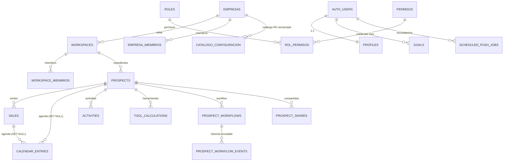

| Grupo | Tablas |
|-------|--------|
| CRM | `prospects`, `sales`, `calendar_entries`, `activities`, `goals`, `tool_calculations`, `prospects_deleted` (tombstones), `prospect_archivos`, `prospect_workflows`, `prospect_workflow_events` |
| Tenant y RBAC | `empresas`, `workspaces`, `workspace_miembros`, `empresa_miembros`, `roles`, `permisos`, `rol_permisos`, `usuario_permisos_override`, `workspace_usuario_permisos_override`, `permisos_delegados`, `gerente_acceso_cruzado` |
| Flags y paquetes | `flags`, `flag_reglas`, `paquetes_acceso`, `paquete_flags` |
| Colaboración y red | `prospect_shares`, `prospect_share_invites`, `share_permission_requests`, `user_connections`, `direct_messages`, `chat_conversations`, `chat_members`, `chat_messages` |
| Notificaciones y soporte | `push_subscriptions`, `scheduled_push_jobs`, `notification_cooldowns`, `support_requests`, `support_request_replies`, `logs_administracion`, `platform_sessions` |
| Survey y premium | `survey_preguntas`, `survey_preguntas_usuario`, `planes`, `membresias`, `funciones_premium`, `modulo_custom_datos` |
| Royal Holiday | `catalogo_configuracion` y tablas `rh_*` (catálogo: `rh_bottom_line`, `rh_financiamiento`, `rh_comisiones`, `rh_regalos`…; operación: `rh_ventas`, `rh_premanifiesto`, `rh_linea_asignacion`, `rh_okr`, `rh_propinas`, `rh_money_box_config`…) |

### Workspaces, membresías, roles, permisos y flags

- `workspaces.tipo` ∈ `personal` | `sala_de_venta` ([`0052_multi_workspace_slack.sql`](../supabase/migrations/0052_multi_workspace_slack.sql)). Cada usuario tiene un workspace personal; una sala pertenece a una empresa. Los datos no se mueven entre personal y sala.
- `profiles.workspace_activo_id` guarda el workspace activo; la sesión lo resuelve y se puede cambiar con `POST /api/v1/auth/workspace`.
- `roles.scope` ∈ `plataforma` | `empresa` | `workspace` ([`0054_tenant_rbac_security.sql`](../supabase/migrations/0054_tenant_rbac_security.sql)). Los roles de plataforma (`superadmin`, `admin`, `liner`, `soporte`) tienen `empresa_id` nulo; cada empresa tiene sus puestos (`gerente`, `liner`, `cerrador`, `marketing`, `opc`, `asistente_sala`, `asistente_empresa`).
- Permisos efectivos = permisos del rol ∪ overrides aditivos ([`0063_rbac_additive_overrides.sql`](../supabase/migrations/0063_rbac_additive_overrides.sql)). El admin de empresa tiene un atajo a las claves de capa `app` ([`0090_empresa_admin_exclude_capa_admin.sql`](../supabase/migrations/0090_empresa_admin_exclude_capa_admin.sql)). En un workspace personal los permisos salen del rol del perfil.
- Flags: paquetes de acceso + reglas → `flags` en la sesión ([`0051_feature_flags.sql`](../supabase/migrations/0051_feature_flags.sql)).

### RLS a nivel conceptual

- Cada fila del CRM pertenece a un usuario (`user_id`) y a un workspace (`workspace_id`). Leer exige acceso al workspace del expediente (dueño, miembro o share); escribir exige además el permiso de acción correspondiente en ese workspace.
- La API usa el JWT del usuario (no la clave de servicio) en las rutas de usuario, así que RLS es la última barrera aunque la API valide antes.
- Los canales Realtime de expediente están restringidos a quien puede acceder al expediente; desde la migración 0098 también pueden emitir Broadcast (bloqueo de campos).
- El historial de workflow es de solo inserción, y los borrados de expediente dejan tombstone.

El detalle de políticas y su revisión es material de operaciones y no se publica aquí.

---

## 7. Funcionamiento y flujos

### 7a. Autenticación y sesión

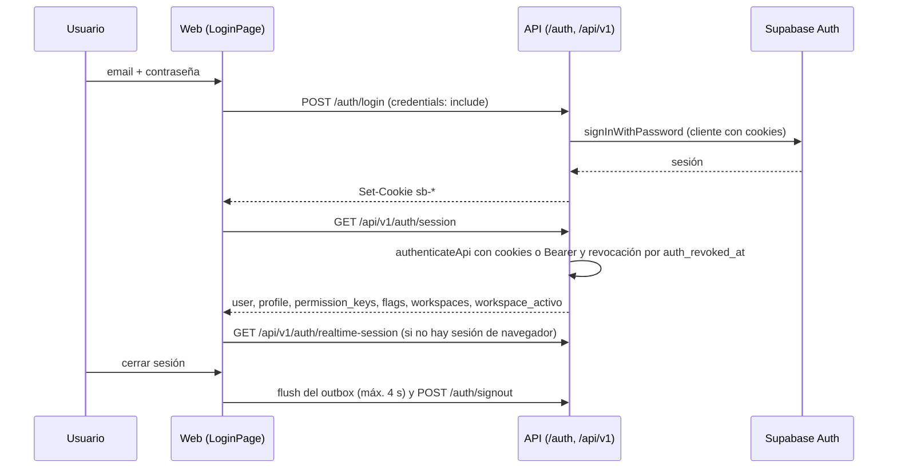

- El web no envía Bearer: usa cookies (`@supabase/ssr`). La API también acepta `Authorization: Bearer` (scripts y smokes).
- El workspace activo se resuelve en este orden: preferido, `workspace_activo_id`, personal, primero disponible ([`apps/api/src/services/session-service.js`](../apps/api/src/services/session-service.js)).
- El logout revoca globalmente, limpia el estado local y avisa a las otras pestañas mediante `sts4_auth_sync`.
- Archivos: [`apps/web/src/pages/LoginPage.jsx`](../apps/web/src/pages/LoginPage.jsx), [`apps/web/src/lib/session-api.js`](../apps/web/src/lib/session-api.js), [`apps/web/src/lib/supabase/ensure-browser-session.js`](../apps/web/src/lib/supabase/ensure-browser-session.js), [`apps/api/src/routes/auth.js`](../apps/api/src/routes/auth.js), [`apps/api/src/controllers/auth-controller.js`](../apps/api/src/controllers/auth-controller.js), [`apps/api/src/routes/session.js`](../apps/api/src/routes/session.js), [`apps/api/src/middleware/auth.js`](../apps/api/src/middleware/auth.js).

### 7b. Arranque offline-first y almacenamiento local

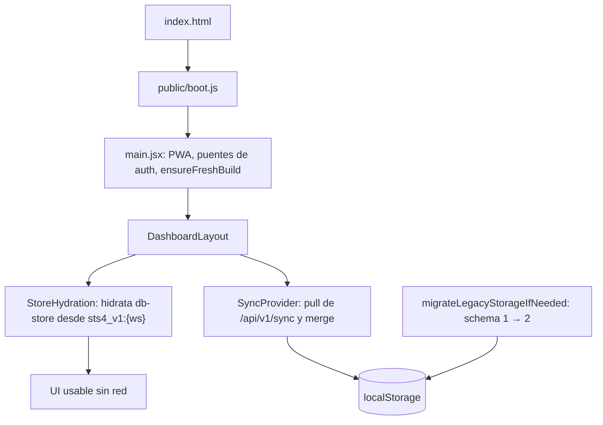

- Solo **localStorage** (no IndexedDB). El esquema 2 (`sts4_schema`) separa el blob del CRM por workspace (`sts4_v1:{workspaceId}`), las preferencias del usuario (`sts4_user_v1`), el workspace activo, el dueño del blob (`sts4_account`) y el outbox (`sts4_outbound_v1:{workspaceId}`).
- Archivos: [`apps/web/index.html`](../apps/web/index.html), [`public/boot.js`](../public/boot.js), [`apps/web/src/main.jsx`](../apps/web/src/main.jsx), [`apps/web/src/layouts/DashboardLayout.jsx`](../apps/web/src/layouts/DashboardLayout.jsx), [`apps/web/src/components/providers/store-hydration.jsx`](../apps/web/src/components/providers/store-hydration.jsx), [`apps/web/src/lib/storage/keys.ts`](../apps/web/src/lib/storage/keys.ts), [`apps/web/src/lib/storage/local-storage-adapter.ts`](../apps/web/src/lib/storage/local-storage-adapter.ts), [`apps/web/src/stores/db-store.ts`](../apps/web/src/stores/db-store.ts).

### 7c. Sincronización

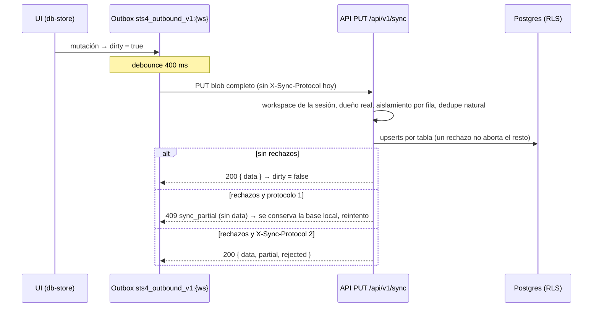

- **Bulk:** `GET` y `PUT /api/v1/sync` ([`apps/api/src/routes/sync.js`](../apps/api/src/routes/sync.js), [`apps/api/src/controllers/sync-controller.js`](../apps/api/src/controllers/sync-controller.js), [`apps/api/src/services/sync-service.js`](../apps/api/src/services/sync-service.js) y la lógica de reconciliación en [`packages/shared/src/data/sync.js`](../packages/shared/src/data/sync.js), que solo usa la API). El alcance es el workspace de la sesión, no el del cuerpo.
- **Tramo 1** (desplegado en `72a3ca4`): las filas nuevas toman el workspace de la sesión, se conserva el dueño real (no se reescriben filas ajenas), los fallos se aíslan por fila, hay idempotencia por clave natural (un mismo blob reenviado con ids distintos no duplica) y un `409 sync_partial` evita que el cliente borre su base local ([`arquitectura/sync-fix-diseno.md`](./arquitectura/sync-fix-diseno.md)).
- **REST por entidad:** `/api/v1/prospects`, `/sales`, `/calendar-entries`, `/goals`, `/tool-calculations`, `/activities`. El cliente las usa para cambios puntuales y cae al outbox si fallan ([`apps/web/src/lib/cloud-persist.js`](../apps/web/src/lib/cloud-persist.js)).
- **Reintentos:** al fallar, el outbox queda `dirty` y reintenta al volver la conexión, al pasar a primer plano, en `auth:resume` y al recargar. **No hay backoff exponencial** (es deuda del Tramo 2).
- Archivos del cliente: [`apps/web/src/lib/sync-api.js`](../apps/web/src/lib/sync-api.js), [`apps/web/src/lib/sync-outbox.js`](../apps/web/src/lib/sync-outbox.js), [`apps/web/src/lib/sync-outbound.js`](../apps/web/src/lib/sync-outbound.js), [`apps/web/src/components/providers/sync-provider.jsx`](../apps/web/src/components/providers/sync-provider.jsx). Prueba del contrato con el cliente real: [`e2e/sync-partial-409.spec.js`](../e2e/sync-partial-409.spec.js).

### 7d. Colaboración en tiempo real

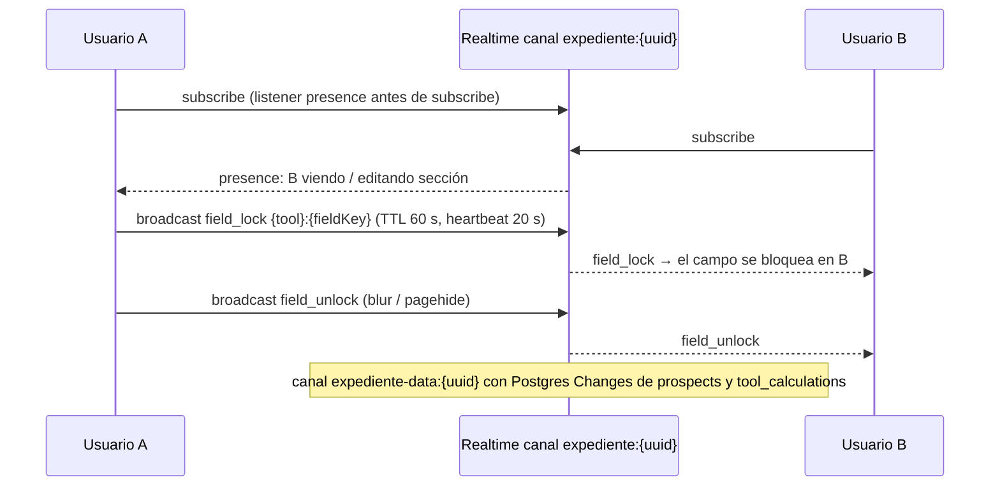

- La sesión de navegador para Realtime se garantiza con cookies o con `GET /api/v1/auth/realtime-session`.
- Los bloqueos huérfanos se limpian cuando el peer sale de Presence o vence el TTL.
- La migración `0098` (en [`supabase/migrations/`](../supabase/migrations/)) habilitó la emisión de Broadcast en los canales de expediente para quien puede acceder al expediente. Está aplicada en producción desde el 2026-10-18, validada con un canario. [`0093_colaboracion_campos.sql`](../supabase/migrations/0093_colaboracion_campos.sql) añade campos de colaboración al workflow del expediente; no es el motor de bloqueos.
- Archivos: [`apps/web/src/lib/expediente-realtime.js`](../apps/web/src/lib/expediente-realtime.js), [`apps/web/src/lib/expediente-field-lock-helpers.js`](../apps/web/src/lib/expediente-field-lock-helpers.js), [`apps/web/src/hooks/use-expediente-realtime.js`](../apps/web/src/hooks/use-expediente-realtime.js), [`apps/web/src/components/clients/collab-field.jsx`](../apps/web/src/components/clients/collab-field.jsx), [`apps/web/src/lib/presence/realtime.js`](../apps/web/src/lib/presence/realtime.js).
- Pendiente: el bloqueo entre varias pestañas del mismo usuario.

### 7e. Notificaciones y recordatorios

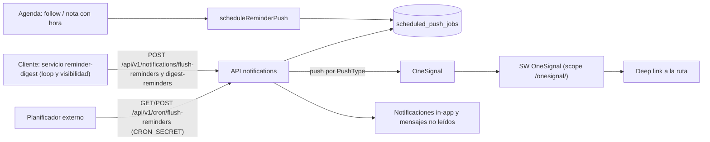

- OneSignal se usa solo en web móvil; en escritorio hay notificaciones locales más Realtime ([`apps/web/src/components/providers/onesignal-provider.jsx`](../apps/web/src/components/providers/onesignal-provider.jsx), [`apps/web/src/lib/onesignal.js`](../apps/web/src/lib/onesignal.js), [`public/OneSignalSDKWorker.js`](../public/OneSignalSDKWorker.js)).
- Tramo B (`503928f`): el dominio puro salió a [`apps/api/src/modulos/notificaciones/`](../apps/api/src/modulos/notificaciones/) (construir recordatorios, preferencias, mapeo de PushType, trabajo programado) y a [`apps/web/src/modulos/notificaciones/`](../apps/web/src/modulos/notificaciones/) (armar notificación, *cooldown* del digest, fecha local). No se tocaron rutas, service worker ni contratos.
- Tramo A (`61b223f`, web-only): Toaster, toasts, in-app y su Realtime, digest/flush, programación de recordatorios, cliente HTTP y Ajustes → Notificaciones en `apps/web/src/modulos/notificaciones/` ([`migraciones/notificaciones.md`](./arquitectura/migraciones/notificaciones.md)). OneSignal (SDK, optIn, service worker) sigue en `lib/` y `public/onesignal/`; no se tocó.
- Tramo C (API): rutas/controladores/servicios/repositorio de reminders, notifications y `cron/flush-reminders` en [`apps/api/src/modulos/notificaciones/`](../apps/api/src/modulos/notificaciones/); fachada exporta también `notify*` para chat/red/sharing/support/auth. Sin cambios de BD ni de `apps/web`. Regla operativa: no llamar flush manual con backend real si hay `scheduled_push_jobs` vencidos de usuarios no-QA (solo lectura previa; detalle en [`migraciones/notificaciones.md`](./arquitectura/migraciones/notificaciones.md) §7).
- Archivos: [`apps/web/src/modulos/notificaciones/servicios/reminder-digest.js`](../apps/web/src/modulos/notificaciones/servicios/reminder-digest.js), [`apps/api/src/modulos/notificaciones/rutas/notifications.js`](../apps/api/src/modulos/notificaciones/rutas/notifications.js), [`apps/api/src/modulos/notificaciones/rutas/cron-flush-reminders.js`](../apps/api/src/modulos/notificaciones/rutas/cron-flush-reminders.js), [`apps/api/src/modulos/notificaciones/servicios/push-notificaciones.js`](../apps/api/src/modulos/notificaciones/servicios/push-notificaciones.js), [`packages/shared/src/push/notification-targets.js`](../packages/shared/src/push/notification-targets.js), [`supabase/migrations/0033_scheduled_push_jobs.sql`](../supabase/migrations/0033_scheduled_push_jobs.sql).
- Quién invoca el cron en producción (planificador concreto): **por confirmar** en el apéndice privado.

### 7f. Cálculo de herramientas

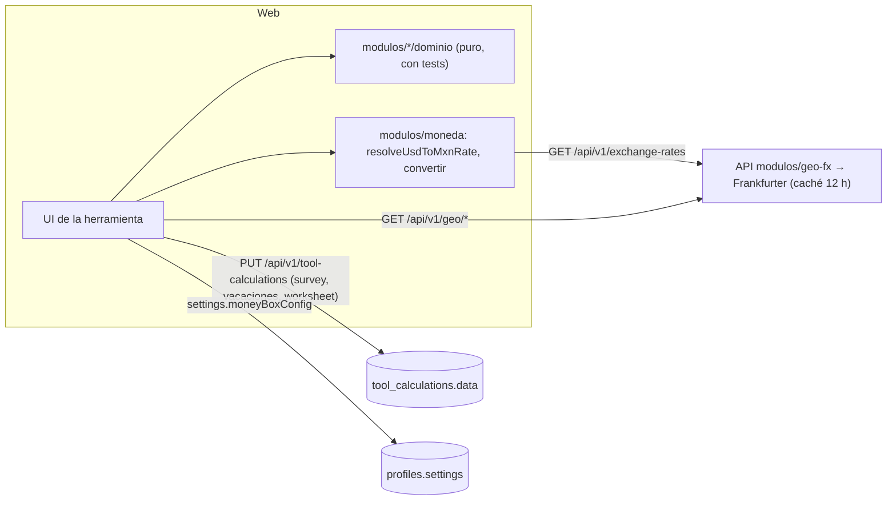

| Herramienta | Dominio | Persistencia |
|-------------|---------|--------------|
| Money Box | [`apps/web/src/modulos/money-box/dominio/calculo-money-box.ts`](../apps/web/src/modulos/money-box/dominio/calculo-money-box.ts): escenarios por enganche o mensualidad | `settings.moneyBoxConfig`; en RH, `rh_money_box_config` por empresa |
| Worksheet | [`apps/web/src/components/calculators/worksheet-page.jsx`](../apps/web/src/components/calculators/worksheet-page.jsx), estándar (`wv`, `we`, `wcc`, `wob`) o RH | `tool_calculations` slug `worksheet` |
| Vacaciones | [`apps/web/src/modulos/vacaciones/dominio/calculo-vacaciones.ts`](../apps/web/src/modulos/vacaciones/dominio/calculo-vacaciones.ts) | slug `vacaciones` |
| Survey | [`apps/web/src/modulos/survey/dominio/calculo-survey.ts`](../apps/web/src/modulos/survey/dominio/calculo-survey.ts), con banco de preguntas Discovery y configuración por usuario o sala (`GET`/`PUT /api/v1/survey/questions-config`) | slug `survey` (`disc_json` + campos planos) |
| Metas | [`apps/web/src/modulos/metas/`](../apps/web/src/modulos/metas/) (KPIs, semanas del tablero) y [`apps/api/src/modulos/metas/`](../apps/api/src/modulos/metas/) | tabla `goals` (`/api/v1/goals`) |
| Moneda / FX | [`apps/web/src/modulos/moneda/`](../apps/web/src/modulos/moneda/): USD, MXN, CAD y EUR; una tasa USD→MXN ≤ 1 se trata como ausente (18 por omisión) | `profiles.settings` |
| geo-fx | [`apps/api/src/modulos/geo-fx/`](../apps/api/src/modulos/geo-fx/): catálogo geográfico estático y tipo de cambio con caché | sin BD |

Regla del Survey (desde `dc22a0f`): en un workspace **personal**, el dueño puede configurar sus preguntas; en una **sala**, el `PUT` exige `herramientas:survey_configurar_preguntas`.

### 7g. Permisos, flags y RBAC

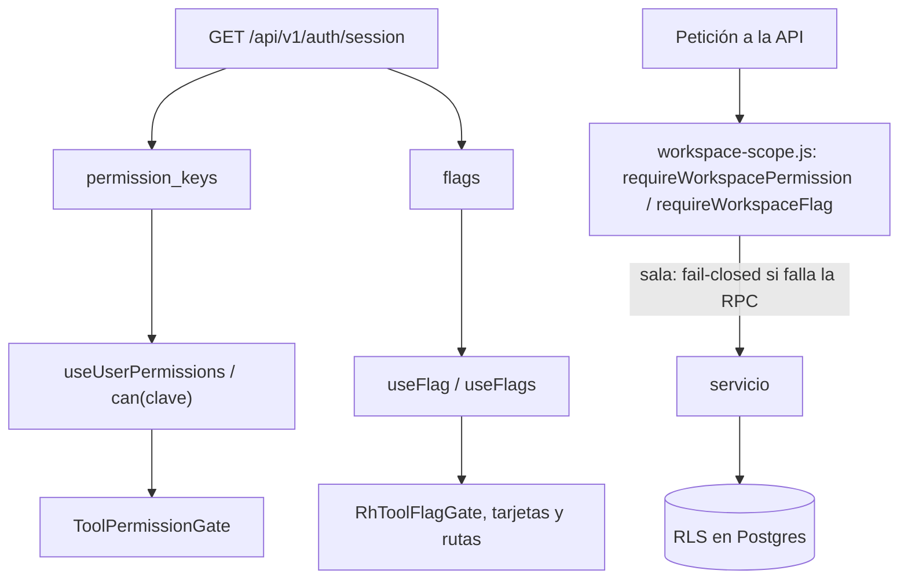

- La UI solo **oculta**; quien **decide** es la API (y RLS detrás). Una herramienta visible por flag puede seguir rechazando acciones sin permiso.
- Archivos: [`packages/shared/src/auth/permission-catalog.js`](../packages/shared/src/auth/permission-catalog.js), [`packages/shared/src/auth/resolve-permissions.js`](../packages/shared/src/auth/resolve-permissions.js), [`apps/web/src/hooks/use-user-permissions.js`](../apps/web/src/hooks/use-user-permissions.js), [`apps/web/src/hooks/use-flag.js`](../apps/web/src/hooks/use-flag.js), [`apps/web/src/components/auth/ToolPermissionGate.jsx`](../apps/web/src/components/auth/ToolPermissionGate.jsx), [`apps/web/src/components/auth/RhToolFlagGate.jsx`](../apps/web/src/components/auth/RhToolFlagGate.jsx), [`apps/api/src/lib/workspace-scope.js`](../apps/api/src/lib/workspace-scope.js), [`apps/api/src/services/empresa-roles-seed.js`](../apps/api/src/services/empresa-roles-seed.js).

### 7h. Agenda / calendario

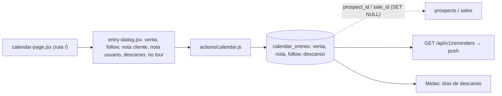

- "No tour" se guarda como `nota` con `kind: no-tour`. La entrada puede enlazar un expediente o una venta.
- Archivos: [`apps/web/src/components/calendar/calendar-page.jsx`](../apps/web/src/components/calendar/calendar-page.jsx), [`apps/web/src/components/calendar/entry-dialog.jsx`](../apps/web/src/components/calendar/entry-dialog.jsx), [`apps/web/src/actions/calendar.js`](../apps/web/src/actions/calendar.js), [`apps/api/src/routes/calendar.js`](../apps/api/src/routes/calendar.js), [`apps/api/src/modulos/notificaciones/dominio/construir-recordatorios.js`](../apps/api/src/modulos/notificaciones/dominio/construir-recordatorios.js).

### 7i. Royal Holiday

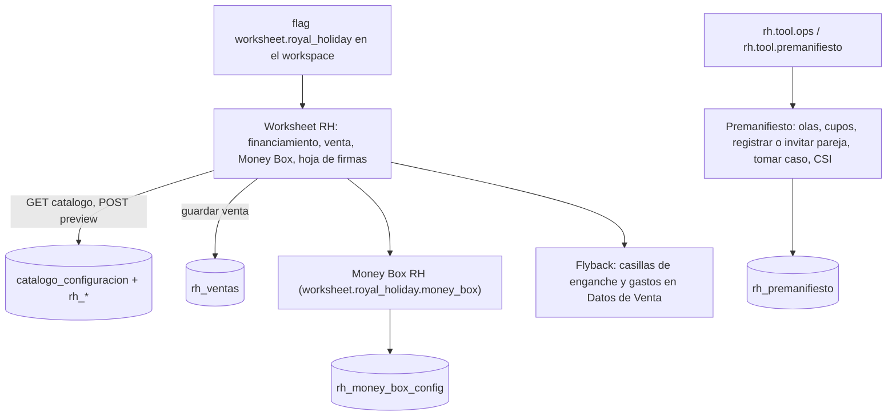

- La API vive en `/api/v1/royal-holiday/:empresaId/*` ([`apps/api/src/routes/royal-holiday.js`](../apps/api/src/routes/royal-holiday.js)): catálogo, preview, ventas, config de Money Box, premanifiesto, línea, OKR, resumen, propinas, descansos y comisiones.
- Hay dos flujos de venta que conviven: `sales` (dashboard y metas) y `rh_ventas` (Worksheet RH). Guardar en RH no alimenta las metas ([`ROLES-Y-PERMISOS.md`](./ROLES-Y-PERMISOS.md) §7).
- Fix de la semana: el deep link `?sub=moneybox` del Worksheet RH embebido vuelve a funcionar (`02f1864`).
- Documentación de producto: [`royal-holiday/README.md`](./royal-holiday/README.md), [`FLUJO-USUARIO-ROYAL-HOLIDAY.md`](./FLUJO-USUARIO-ROYAL-HOLIDAY.md), [`royal-holiday/PREMANIFIESTO-CSI-CAPACITACION.md`](./royal-holiday/PREMANIFIESTO-CSI-CAPACITACION.md).
- Archivos: [`apps/web/src/components/calculators/worksheet-royal-holiday-page.jsx`](../apps/web/src/components/calculators/worksheet-royal-holiday-page.jsx), [`apps/web/src/modulos/money-box/`](../apps/web/src/modulos/money-box/), [`apps/web/src/lib/calculations/worksheet-rh-bucket.js`](../apps/web/src/lib/calculations/worksheet-rh-bucket.js).

---

## 8. Internacionalización y PWA

### i18n

- Idiomas: **español** (por omisión) e **inglés** (cuando `settings.language === "en"`) ([`apps/web/src/lib/i18n.js`](../apps/web/src/lib/i18n.js)).
- Catálogos: el base en `i18n.js`, las extensiones en [`apps/web/src/lib/i18n-catalog.js`](../apps/web/src/lib/i18n-catalog.js), [`apps/web/src/lib/i18n-phase2-catalog.js`](../apps/web/src/lib/i18n-phase2-catalog.js) y [`apps/web/src/lib/i18n-phase3-catalog.js`](../apps/web/src/lib/i18n-phase3-catalog.js), y el catálogo Discovery del Survey en [`apps/web/src/modulos/survey/i18n/`](../apps/web/src/modulos/survey/i18n/).
- Agregar una clave: añadirla **en ES y en EN** en el mismo catálogo y usarla con `t("clave")` / `useI18n`; no escribir texto literal en componentes. Las claves existentes son contrato.
- Preguntas Discovery: editar [`apps/web/src/modulos/survey/i18n/build-catalogo-discovery.mjs`](../apps/web/src/modulos/survey/i18n/build-catalogo-discovery.mjs) y regenerar con `node scripts/build-survey-discovery-i18n.mjs` (wrapper temporal hacia el builder canónico).

### PWA y service worker

- `vite-plugin-pwa` en [`apps/web/vite.config.js`](../apps/web/vite.config.js), con `registerType: "autoUpdate"` y registro manual en [`apps/web/src/lib/pwa-register.js`](../apps/web/src/lib/pwa-register.js).
- Workbox precachea JS, CSS e imágenes (no `index.html` ni OneSignal). En runtime: *NetworkOnly* para API, auth, HTML, el propio SW y OneSignal; *StaleWhileRevalidate* para assets; *CacheFirst* para imágenes.
- El SW de OneSignal es aparte, con scope `/onesignal/`, y no se precachea.
- `ensureFreshBuild` (en `main.jsx`) y el build-id con el SHA de git evitan servir builds viejos tras un deploy.

---

## 9. Pruebas y calidad

### Suites

| Comando | Qué cubre |
|---------|-----------|
| `npm run test:web` | Unitarios de web (`node --test`): settings-scope, expediente, bloqueo de campos, dominio de moneda, metas, vacaciones, survey y notificaciones |
| `npm run test:security` | Unitarios de la API (alias de `npm run test:security -w @salesapp/api`): seguridad de la app, rate limit, workspace-scope, permisos de edición, contrato MVC, cachés, servicio de preguntas del Survey y **reconcile de sync** (incluye los guards de la regresión de sync) |
| `npm run test:geo-fx`, `npm run test:moneda`, `npm run test:metas`, `npm run test:vacaciones`, `npm run test:survey`, `npm run test:money-box`, `npm run test:rh-regalos` | Suites por módulo |
| `npm run test:e2e` | Playwright completo (levanta `dev:api` y `dev:web` salvo con `PLAYWRIGHT_SKIP_SERVERS`) |
| `npm run e2e:comparar-baseline` | Compara un reporte de Playwright con la baseline de fallos conocidos |
| `npm run verificar:arquitectura:checks` | Los 7 checks de la [sección 4.4](#44-checks-de-arquitectura) más el test del comparador |
| `npm run verificar:arquitectura:completo` | Checks + `test:security` + `build:web:ci` + `verify` y smoke E2E si hay pila local |
| `npm run build:web:ci` | Build de Vite con placeholders, para atrapar imports o fachadas rotas |
| `npm run verify`, `npm run verify:security-smoke` | Smokes HTTP contra una pila levantada |

Los **smokes contra producción** (`scripts/architecture/smoke-*-qa.mjs`) usan cuentas QA efímeras con credenciales aleatorias fuera del repo y purgan a 0 al terminar. Por ejemplo, [`scripts/architecture/smoke-sync-roundtrip-qa.mjs`](../scripts/architecture/smoke-sync-roundtrip-qa.mjs) prueba fila nueva, reenvío idempotente, 409 y conservación del dueño. No corren en CI porque necesitan la BD real.

### CI

| Workflow | Cuándo corre | Qué hace |
|----------|--------------|----------|
| [`architecture.yml`](../.github/workflows/architecture.yml) (Arquitectura) | push a `main`, `test/arquitectura-red-seguridad` y `arquitectura/**`; PR a `main` | `npm ci`, `verificar:arquitectura:checks`, `test:security`, `build:web:ci` (Node 20) |
| [`e2e.yml`](../.github/workflows/e2e.yml) (E2E) | push a `main` y `arquitectura/**`; PR a `main` | Playwright completo en Chromium (`CI=true`: 1 worker, 1 reintento) |
| [`migrate.yml`](../.github/workflows/migrate.yml) (Migrate) | Solo manual (`workflow_dispatch`) | Aplica una migración por prefijo con el secreto de BD del repo; solo con OK explícito |

### Reglas vigentes

- **Baseline E2E en 0 fallos** en `main` ([`arquitectura/e2e-baseline.md`](./arquitectura/e2e-baseline.md)). Cifra actual: 156 pasan, 5 omitidas, 0 fallos. La baseline solo puede encoger.
- **Deploy solo con CI verde del SHA exacto**: Arquitectura en verde y E2E con 0 fallos en el mismo SHA que se despliega. Si el CI sale rojo, se revierte con `git revert` (sin force) y no se despliega.
- Un test que solo pasa cambiando la BD de producción es motivo para **parar y preguntar** ([`arquitectura/regla-prod-db-sin-ok.md`](./arquitectura/regla-prod-db-sin-ok.md)).

---

## 10. Entornos y despliegue

### Entornos

- **Producción:** un servidor propio con Nginx (SPA estático y proxy), la API con PM2 y Supabase autoalojado. Si existe un staging y para qué se usa: **por confirmar** (apéndice privado).
- **Local:** `dev:api` y `dev:web`. El archivo de entorno local puede apuntar a servicios reales, así que toda prueba que escriba datos usa **QA efímera + purga** ([`arquitectura/entornos.md`](./arquitectura/entornos.md), opción D). Un Supabase local o un staging separado están propuestos y sin implementar.
- **CI:** GitHub Actions sin acceso a la BD real (E2E con mocks y semilla local).

### Proceso de despliegue (general)

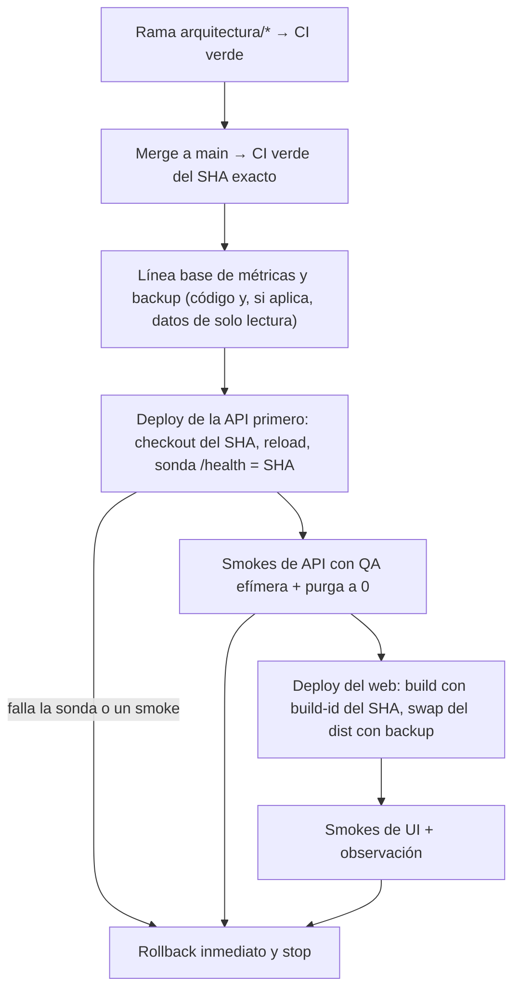

- **Orden:** API primero y web después, para que el web nuevo nunca hable con una API vieja. Hay deploys que son solo de API o solo de web.
- **Verificación:** `/health` devuelve el SHA desplegado (`commit`, leído de `API_BUILD_ID` o de un `SHA.txt` escrito en el deploy, desde `e809e3f`), y el deploy se aborta si no coincide.
- **Backups:** antes de cada deploy, copia del código o del `dist` con su SHA y un `ROLLBACK.md`. Antes de cambios que alteran patrones de escritura, dump de solo lectura de las tablas afectadas. Los backups de datos viven fuera del repo con permisos restringidos y tienen fecha de borrado ([`arquitectura/retencion-backups-vps.md`](./arquitectura/retencion-backups-vps.md)).
- **Rollback:** volver al SHA anterior y recargar con sonda; en el web, restaurar el `dist` anterior. Cada plan de deploy tiene su `ROLLBACK-*.md` en `docs/arquitectura/`.
- **Base de datos:** ningún cambio sin OK explícito, backup y rollback preparados.
- Hosts, rutas, comandos y credenciales: **solo en el apéndice privado de operaciones**.

---

## 11. Cambios de la semana (11–18 oct 2026)

Construido con `git log main` y `docs/arquitectura/`. Las fechas son las del commit (UTC−5); los deploys se indican aparte. "Revertir" es el procedimiento general; los comandos concretos están en cada `ROLLBACK-*.md` o en el apéndice privado.

### Cronología

| Fecha | SHA | Qué cambió | Por qué | Resultado | Cómo revertir |
|-------|-----|------------|---------|-----------|---------------|
| 10-11 | `288ab6f`…`a93455e` | Higiene del repo: fuera el inventario vivo de docs y el archivo de scripts antiguos; `.env.example`; README de scripts; `.gitattributes`; build-id con SHA y bloqueo de deploy con árbol sucio (`1372f76`); verificación de cabeceras edge (`395b341`) | Reducir material obsoleto y hacer trazable cada build | En `main` | `git revert` del commit (solo tooling y docs) |
| 10-12 | `192467b`, `7933cbf` | `usdToMxnRate`: no persistir `exchangeRate = 1` como tasa de captura; una tasa ≤ 1 o no numérica se normaliza como ausente al hidratar y al guardar | Había perfiles con 1 USD = 1 MXN que falseaban las conversiones | Desplegado en el web | `git revert` + redeploy del web |
| 10-12 | — (datos) | **Migración de datos** de `usdToMxnRate`: se quitó la clave en los perfiles que la tenían ≤ 1 (2 perfiles), con backup previo fuera del repo | Limpiar los valores ya guardados | Verificación de solo lectura: 0 filas malas en el día 1 y en el día 3 (10-17); la del día 7 vence el **2026-10-19** | Restaurar los valores desde el backup (apéndice privado) |
| 10-13 | `d145fee` | Auditoría Fase 0 de estructura y contratos | Base para decidir la arquitectura | [`auditoria-fase0.md`](./arquitectura/auditoria-fase0.md) | Solo docs |
| 10-13 | `9f2b5ac`, `7b3f35b` | **Red de seguridad Fase 1**: decisiones, checks (límites de capas, lazy, contratos de tools, push, paridad shared), workflow Arquitectura, baseline funcional y `verificar:arquitectura:completo` | Poder mover módulos sin romper contratos | Checks en CI. **Efecto colateral:** regeneró `mappers.js` de shared desde el web (ver la regresión de sync) | `git revert` (el efecto colateral ya se corrigió en `1f86f78`) |
| 10-13 | `6a1e0b0`, `054f0ab` | Módulo 1 **geo-fx** (piloto): caracterización, dominio, servicios, controladores y rutas en `modulos/geo-fx` | Validar el patrón A+B | Desplegado (API + web) el 10-13; contratos `/geo` y `/exchange-rates` intactos | `git revert` + redeploy |
| 10-13 | `4d3c231`, `d60c8a4` | Módulo 2 **moneda** (web) | Centralizar conversión y tasa | Desplegado (web) | `git revert` + redeploy del web |
| 10-13 | `19586a0` | Módulo 3 **metas** (API + web) | — | Desplegado | `git revert` + redeploy |
| 10-14 | `92e569f` | Módulo 4 **vacaciones** (web) | — | Desplegado (web) | `git revert` + redeploy del web |
| 10-14 | `3e678e5`, `c27cc38` | **Contención legacy y fachadas**: carpetas congeladas, imports por fachada, `test:security` en CI; `fachada-node.js` en moneda | Que el código nuevo viva en `modulos/` y no crezca el legacy | Checks en CI | `git revert` |
| 10-14 | `ba34a70` | Survey **5a**: dominio `calculo-survey` + fachada | — | En `main` | `git revert` |
| 10-14 | `1e712d3`, `a90e36a`, `e8a5b01` | Gate de colaboración del Survey (con *known gap* de bloqueo) y regla "BD de producción sin OK" | Proteger producción durante la migración | Regla siempre activa | `git revert` (docs y tests) |
| 10-14 | — (BD, incidente) | Intento de habilitar Broadcast en los canales de expediente: la prueba negativa detectó un alcance mayor del esperado y se **revirtió** el mismo día | — | Sin cambio neto en producción; se rediseñó como 0098 con canario | Ya revertido |
| 10-14 | `9d690ef`…`17066f1` | Survey **5b.1–5b.5**: paneles, `SurveyPage` lazy, UI Discovery, catálogo i18n Discovery, banco y resolución de preguntas | — | Desplegado (web) | `git revert` + redeploy del web |
| 10-15 | `b31a4bd`, `b02b3fa`, `ba4026d`, `eeb90b9` | Survey **5b.6**: config de preguntas a `modulos/survey` en web y API; se documenta el hueco de permiso del `PUT` | — | Desplegado `eeb90b9` (API + web, 10-17) | `git revert` + redeploy |
| 10-17 | `6d6d2be` | Corte 2 | — | [`corte-2.md`](./arquitectura/corte-2.md) | Solo docs |
| 10-17 | `0e475e8`, `a81578c`, `38580ad` | Módulo 6 **money-box** (web) + smoke de matriz a/b/c/d | — | Desplegado (web) | `git revert` + redeploy del web |
| 10-17 | `a2c3162`, `503928f` | Módulo 7 **notificaciones**: inventario y **Tramo B** (dominio puro, API + web) | Separar lógica pura sin tocar SW ni contratos | Desplegado (API) | `git revert` + redeploy de la API |
| 10-17 | `18d2993`, `dc22a0f`, `aab2714` | **Permiso del PUT de preguntas**: en personal configura el dueño; en sala exige `herramientas:survey_configurar_preguntas` | La UI y la API no coincidían | Desplegado `aab2714` (API + web) | [`ROLLBACK-permiso-put-preguntas.md`](./arquitectura/ROLLBACK-permiso-put-preguntas.md) |
| 10-17 | `2b7f108`, `b022a1d`, `b6f0816` | Diseño de 0098 y **cliente de bloqueo de campos** (desbloqueo al salir, semilla de share) | Preparar el canario | Desplegado como parte de `fe26b10` (web) | `git revert` + redeploy del web |
| 10-17 | `fe26b10`, `68003a1` | Baseline E2E de **18** fallos conocidos + comparador; corte 3 | El CI E2E llevaba rojo desde al menos el 10-10 sin bloquear deploys | Desplegado `fe26b10` (web, 10-18) | Solo docs y tooling |
| 10-17 | `8b59907` | Saneamiento E2E **18 → 1** (solo `e2e/` y comparador) | Las pruebas leían claves de almacenamiento antiguas, faltaban flags en los mocks y había selectores obsoletos | 1 fallo real de app restante | `git revert` |
| 10-18 | `9b17c80` | **0098 aplicada** en producción (canario ii-bis); el gate de colaboración exige bloqueo | El bloqueo de campos no llegaba al otro usuario | Todos los criterios OK; bloqueo = PASS | [`docs/arquitectura/rollback-0098-broadcast-expediente.sql`](./arquitectura/rollback-0098-broadcast-expediente.sql) con OK |
| 10-18 | `02f1864`, `6679b7a` | **Fix `?sub=moneybox`**: el fallback de pestaña esperaba a que resolviera el flag | Bug de deep link desde `4703d65` | E2E **1 → 0**; desplegado (web `6679b7a`) | [`deploy-fix-sub-moneybox.md`](./arquitectura/deploy-fix-sub-moneybox.md) |
| 10-18 | `f873442`, `1c8887f` | Diagnóstico de solo lectura de `sync.reconcile` y diseño del fix con pruebas de caracterización | Los `PUT /sync` fallaban | Causa raíz identificada | Solo docs y tests |
| 10-18 | `e809e3f` | **`/health` con SHA** (`API_BUILD_ID` o `SHA.txt`) y comparador E2E con flag `m` y test con el resumen real del CI | `/health` devolvía `commit: null`; el comparador perdía el último fallo de cada bloque | Desplegado con `72a3ca4` | `git revert` + redeploy de la API |
| 10-18 | `c2b838e` | Workflows Arquitectura y E2E también en push a `arquitectura/**` | Tener CI antes del merge | Activo | `git revert` |
| 10-19 | `61b223f` → tip `242f44d` | Módulo 7 **notificaciones, Tramo A** (web): merge FF + deploy web-only; docs de cierre en el tip | Sacar del legacy la UI y los servicios de notificaciones sin tocar OneSignal, SW, API ni contratos | CI verde; smokes prod OK; `build-id` = tip; API sigue en `72a3ca4` | `git revert` + restaurar `web-dist/pre-20261019-101247` |
| 10-19 | `149e280` → tip `c3d03b1` (cierre docs posterior) | Módulo 7 **notificaciones, Tramo C** (API): merge FF + deploy API | Contener reminders/notifications/flush en `modulos/notificaciones` sin tocar contratos ni web | CI tip verde; API prod alineada al tip de código; web sigue `c621b92`; backup API stamp 20261019-161532 | [`ROLLBACK-api-notificaciones-tramo-c.md`](./arquitectura/ROLLBACK-api-notificaciones-tramo-c.md) → `72a3ca4` |
| 10-18 | `1f86f78`, `4fe9465`, `3f75b3a`, `72a3ca4` | **Tramo 1 de `PUT /sync`** + smoke de roundtrip, guard de `sync:shared`, baseline 156, plan de deploy con backup lógico y criterios de rollback | Corregir la regresión de sync | **Desplegado `72a3ca4` (API) el 10-18**: CI verde, (a)–(e) en verde en producción, 0 errores 5xx | [`ROLLBACK-api-sync-tramo1.md`](./arquitectura/ROLLBACK-api-sync-tramo1.md) |

### Regresión de `PUT /sync`

- **Causa:** `9f2b5ac` regeneró `packages/shared/src/data/mappers.js` a partir del web con `sync:shared`. La copia del servidor perdió el estampado de `workspace_id` y la conservación del dueño, que el web nunca tuvo. Con eso, cualquier fila nueva subía sin workspace y RLS la rechazaba, y un primer fallo abortaba todo el `PUT`.
- **Ventana:** la primera API con ese commit se desplegó el **2026-10-13** (con `054f0ab`). Desde el **14-10** hubo 0 sincronizaciones correctas de usuarios con expedientes. La corrección se desplegó el **2026-10-18** (`72a3ca4`).
- **Corrección (Tramo 1, solo API):** la lógica del servidor se movió a `packages/shared/src/data/sync.js`, un archivo que no se regenera desde el web: workspace de la sesión, dueño real, aislamiento por fila, idempotencia y `409 sync_partial` ([`sync-fix-diseno.md`](./arquitectura/sync-fix-diseno.md), [`deploy-api-sync-tramo1.md`](./arquitectura/deploy-api-sync-tramo1.md)).
- **Pendiente:** confirmar con tráfico real que los usuarios afectados vuelven a sincronizar (en la primera media hora después del deploy no hubo `PUT /sync` reales) y el Tramo 2 de cliente.

### Lecciones aprendidas

| Qué falló | Guard añadido |
|-----------|---------------|
| Una regeneración automática (`sync:shared`) borró en silencio lógica del servidor | Regla: la lógica del servidor va en archivos solo de shared (`sharedOnlyNoted` en `sync-shared-files.json`). Dos guards en `test:security`: el estampado de workspace y dueño (comprobado con mutaciones) y que `sync.js` nunca entre en `pairs` |
| El E2E estaba rojo desde al menos el 10-10 y se desplegó con el E2E aún en curso | Baseline explícita (18 → 0), comparador con test y la regla "CI verde del SHA exacto, E2E con 0 fallos" ([`incidente-ci-e2e-baseline-2026-10-18.md`](./arquitectura/incidente-ci-e2e-baseline-2026-10-18.md)) |
| El CI solo corría al llegar a `main` | Workflows también en `arquitectura/**` (`c2b838e`) |
| No se podía verificar qué SHA corría en la API | `/health` con `commit` y sonda del deploy que compara con el SHA esperado (`e809e3f`) |
| Se probó un cambio de BD sin pruebas negativas suficientes (14-10) | Regla de BD sin OK; canario con snapshot previo, positivos y negativos, rollback automático y purga |
| El instrumento del canario midió mal la presencia (0098, primer intento) | Línea base del propio instrumento **antes** del apply; si no da el valor esperado, no se aplica |
| `index.js` junto a `index.ts` en un módulo rompió el build de Vite | Convención `fachada-node.js` y `build:web:ci` en CI |
| Se guardaban tasas de cambio de 1 | Normalización en hidratación y guardado, auditorías de solo lectura a 1, 3 y 7 días |
| El comparador E2E perdía el último fallo de cada bloque de texto | Flag `m` y test con el resumen real del CI |

---

## 12. Deuda técnica y backlog

| Tema | Estado |
|------|--------|
| **Sync, Tramo 2 (cliente)** | Enviar `X-Sync-Protocol: 2` y tratar `partial`/`rejected`; backoff y tope del outbox ante el mismo rechazo; ids estables para no generar ids distintos en cada normalización; filas "pendientes sin subir" visibles para el usuario |
| Sync, Tramo 3 (BD) | Endurecer las reglas de actualización de expedientes (requiere OK de BD) |
| Notificaciones | Tramos B+A+C en `main`. API desplegada `c3d03b1`; web `c621b92`. Pendiente: OneSignal (SDK, optIn, SW) fuera; ~40 consumidores de `@/lib/toast`; `presentarNotificacion("expediente_transferido")` (hoy no alcanzable; ver [`migraciones/notificaciones.md`](./arquitectura/migraciones/notificaciones.md) §7) |
| Auth: refresh token reused | Ruido en pm2: `AuthApiError: Invalid Refresh Token: Already Used` (sesión concurrente / rehydrate; **no** es sync). Investigar si molesta a usuarios; no bloquea deploy |
| Perfiles sin `role_id` | 2 perfiles reales legacy `vendedor` con `role_id` nulo; el operador los asignará a **liner** desde Admin → Usuarios. (Separado de la decisión de rol por defecto al registrarse) |
| Módulos pendientes | Agenda, ventas, expediente/sharing, Royal Holiday, sync/storage/outbox, admin/RBAC, auth/session/PWA |
| Survey 5b.7 | Ids de campos colaborativos y realtime dentro del Survey |
| Bloqueo de campos en varias pestañas | Pendiente |
| Alcance de los canales en tiempo real | Revisión de diseño pendiente de decisión (detalle en el apéndice privado) |
| HTTPS | Pendiente de operaciones |
| Retención de backups | Inventario parcial en [`retencion-backups-vps.md`](./arquitectura/retencion-backups-vps.md); falta la política general |
| Perfiles sin rol por defecto | 2 reales legacy sin `role_id` (asignación manual a liner pendiente). **Decisión de producto pendiente** aparte: rol por defecto al registrarse o no |
| Entornos | Supabase local o staging separado (propuesta en [`entornos.md`](./arquitectura/entornos.md)) |
| Paridad de permisos web ↔ shared | Divergencia intencional documentada |
| Dos flujos de venta (`sales` / `rh_ventas`) | Sin unificar |
| Docs desactualizados | `README.md` (Vercel), [`FLUJO-USUARIO-POR-ROL.md`](./FLUJO-USUARIO-POR-ROL.md) (menú RH), enlaces a docs que ya no están en el repo (ver la [sección 14](#14-glosario-y-mapa-de-documentos)) |

---

## 13. Guía de onboarding

### Levantar el entorno local

```bash
git clone <url-del-repo>
cd sales-app
cp .env.example .env.local      # completa los valores; nunca subas .env.local
npm ci
npm run dev:api                 # API en el puerto 4000 (API_PORT para cambiarlo)
npm run dev:web                 # Vite en el puerto 5173, con proxy de /api y /auth a la API
```

Antes de escribir datos desde local, comprueba a qué backend apunta tu `.env.local` ([`arquitectura/entornos.md`](./arquitectura/entornos.md)). Si es un entorno real, usa solo cuentas QA efímeras y purga al terminar.

### Correr las suites

```bash
npm run verificar:arquitectura:checks   # lo mismo que el CI de Arquitectura (sin build)
npm run test:security                   # API
npm run test:web                        # web
npm run build:web:ci                    # build de Vite con placeholders
npm run test:e2e                        # Playwright (levanta API y web)
npm run verificar:arquitectura:completo # todo lo anterior + verify local si la pila está arriba
```

Para comparar un reporte E2E con la baseline: `npm run e2e:comparar-baseline -- <reporte.json>`.

### Crear un módulo nuevo

1. Escribe la caracterización (tests del comportamiento actual) **antes** de mover nada.
2. Extrae la lógica pura a `apps/<app>/src/modulos/<nombre>/dominio/` con tests.
3. Mueve los archivos con `git mv` a `modulos/<nombre>/` y crea la fachada (`index.ts` en web, `index.js` en API); exporta solo lo público.
4. Actualiza los consumidores para que importen la fachada.
5. Reduce [`scripts/architecture/legacy-baseline.json`](../scripts/architecture/legacy-baseline.json) en el mismo PR. Nunca la amplíes.
6. Si el módulo tiene tests nuevos, añádelos al script `test` o `test:security` del workspace.
7. `npm run verificar:arquitectura:checks` y las suites del módulo; documenta en `docs/arquitectura/migraciones/<nombre>.md`.
8. No renombres contratos (sección 5). Las ramas de refactor no llevan migraciones DDL.

Plantilla completa: [`arquitectura/contencion-y-fachadas.md`](./arquitectura/contencion-y-fachadas.md).

### Agregar una migración

1. Crea `supabase/migrations/NNNN_descripcion.sql` con el siguiente número libre (hoy, el siguiente a `0098`).
2. Escribe el rollback SQL junto al plan en `docs/arquitectura/` y un plan con snapshot previo, pruebas positivas y negativas, y criterios de rollback.
3. **No la apliques a producción sin OK explícito**, backup y rollback preparados. Con OK, se aplica con `npm run db:migrate` ([`scripts/apply-migration.mjs`](../scripts/apply-migration.mjs)) o con el workflow manual Migrate.
4. Registra en el plan que se aplicó y con qué resultado.

### Deploy seguro (pasos)

1. Trabaja en una rama `arquitectura/*`; el CI corre en cada push.
2. Merge a `main` y espera el CI **del SHA exacto de `main`**: Arquitectura en verde y E2E con 0 fallos. Si sale rojo: `git revert` y no se despliega.
3. Mide la línea base (errores, éxitos, latencia) y haz backup del código y, si cambia cómo se escriben datos, un backup de datos de solo lectura.
4. Despliega primero la API: checkout del SHA, reload y sonda de `/health` hasta que `commit` sea ese SHA.
5. Corre los smokes con QA efímera y purga a 0. Si algo falla, rollback inmediato y stop.
6. Si aplica, despliega el web y corre sus smokes.
7. Observa los primeros 15–30 minutos y documenta el resultado en `docs/arquitectura/`.

Los comandos concretos están en el apéndice privado.

---

## 14. Glosario y mapa de documentos

### Glosario

| Término | Significado |
|---------|-------------|
| Expediente | La ficha de un prospecto o cliente en la UI. En el código del dominio es **prospecto**; en la API y la BD, `prospect` / `prospects` |
| Sala / workspace | Sala de ventas de una empresa (`workspaces.tipo = sala_de_venta`). En la API y la BD es `workspace`; también existe el workspace **personal** de cada usuario |
| Empresa (tenant) | Organización dueña de una o más salas |
| Puesto | Rol de un usuario dentro de una empresa o sala (liner, cerrador, gerente, OPC, marketing…) |
| Liner / Cerrador / Gerente | Vendedor, quien cierra la venta y el responsable del equipo |
| OPC | Puesto de Royal Holiday que capta e invita parejas al tour |
| Tour | Visita de una pareja a la presentación de ventas |
| Survey | Herramienta de diagnóstico de la pareja (Discovery, gastos de viaje, timeshare actual) |
| Worksheet | Hoja de cálculo de la oferta y el financiamiento |
| Money Box | Calculadora de escenarios de enganche y mensualidad |
| Premanifiesto | Planificación de parejas por ola y cupo (Royal Holiday) |
| Flyback | Opción de carga en los datos de venta RH (enganche o gastos) |
| Flag | Interruptor que muestra u oculta un módulo o herramienta |
| Permiso (`permission_key`) | Acción autorizada en la API (`expedientes:editar`…) |
| Outbox | Cola local de cambios pendientes de subir |
| Tombstone | Registro de que un expediente se borró, para que no "resucite" al sincronizar |
| QA efímera | Cuenta de prueba creada para un smoke, con contraseña aleatoria, que se purga al terminar |
| Canario | Aplicación vigilada de un cambio en producción, con criterios y rollback automático |
| Fachada | Archivo `index` de un módulo: su único punto de import desde fuera |

Glosario ES/EN de la migración: [`arquitectura/glosario.md`](./arquitectura/glosario.md).

### Mapa de documentos

| Documento | Para qué |
|-----------|----------|
| [`MAPA-GENERAL-SISTEMA.md`](./MAPA-GENERAL-SISTEMA.md) | Recorrido funcional de punta a punta (corte 2026-09-02) |
| [`INFORMACION-TECNICA-SISTEMA.md`](./INFORMACION-TECNICA-SISTEMA.md) | Ficha técnica, fórmula RBAC |
| [`ROLES-Y-PERMISOS.md`](./ROLES-Y-PERMISOS.md) | Roles, menús, aterrizaje y huecos (vigente) |
| [`FLUJO-USUARIO-POR-ROL.md`](./FLUJO-USUARIO-POR-ROL.md), [`FLUJO-USUARIO-ROYAL-HOLIDAY.md`](./FLUJO-USUARIO-ROYAL-HOLIDAY.md) | Experiencia por rol y en sala RH |
| [`ARQUITECTURA-API.md`](./ARQUITECTURA-API.md) | Capas de la API |
| [`JERARQUIA-WORKSPACES-ENTREGABLE.md`](./JERARQUIA-WORKSPACES-ENTREGABLE.md) | Jerarquía de workspaces |
| [`INFORME-SYNC-PWA-DESKTOP.md`](./INFORME-SYNC-PWA-DESKTOP.md), [`DIAGNOSTICO-SYNC-PERSISTENCIA.md`](./DIAGNOSTICO-SYNC-PERSISTENCIA.md), [`INFORME-RAIZ-EXPEDIENTES-SYNC.md`](./INFORME-RAIZ-EXPEDIENTES-SYNC.md) | Sync y persistencia (históricos) |
| [`DIAGNOSTICO-EGRESS.md`](./DIAGNOSTICO-EGRESS.md) | Auditoría de egress (2026-08-20) |
| [`royal-holiday/README.md`](./royal-holiday/README.md) | Catálogo y Worksheet RH |
| [`arquitectura/auditoria-fase0.md`](./arquitectura/auditoria-fase0.md) | Auditoría de estructura y contratos |
| [`arquitectura/decisiones.md`](./arquitectura/decisiones.md) | Decisiones de arquitectura |
| [`arquitectura/baseline-fase1.md`](./arquitectura/baseline-fase1.md) | Baseline de la red de seguridad |
| [`arquitectura/contencion-y-fachadas.md`](./arquitectura/contencion-y-fachadas.md) | Contención legacy, fachadas, plantilla de módulo |
| [`arquitectura/glosario.md`](./arquitectura/glosario.md) | Glosario de la migración |
| [`arquitectura/entornos.md`](./arquitectura/entornos.md) | Propuesta de entornos |
| [`arquitectura/regla-prod-db-sin-ok.md`](./arquitectura/regla-prod-db-sin-ok.md) | Regla de BD de producción |
| [`arquitectura/corte-modulos-1-4.md`](./arquitectura/corte-modulos-1-4.md), [`arquitectura/corte-2.md`](./arquitectura/corte-2.md), [`arquitectura/corte-3.md`](./arquitectura/corte-3.md) | Cortes de estado |
| [`arquitectura/migraciones/`](./arquitectura/migraciones/) | Detalle por módulo migrado |
| [`arquitectura/e2e-baseline.md`](./arquitectura/e2e-baseline.md), [`arquitectura/incidente-ci-e2e-baseline-2026-10-18.md`](./arquitectura/incidente-ci-e2e-baseline-2026-10-18.md) | Baseline E2E e incidente de CI |
| [`arquitectura/sync-fix-diseno.md`](./arquitectura/sync-fix-diseno.md), [`arquitectura/deploy-api-sync-tramo1.md`](./arquitectura/deploy-api-sync-tramo1.md), [`arquitectura/ROLLBACK-api-sync-tramo1.md`](./arquitectura/ROLLBACK-api-sync-tramo1.md) | Fix de sync |
| [`arquitectura/pendiente-permiso-configurar-preguntas.md`](./arquitectura/pendiente-permiso-configurar-preguntas.md), [`arquitectura/deploy-permiso-put-preguntas.md`](./arquitectura/deploy-permiso-put-preguntas.md) | Permiso del PUT de preguntas |
| [`arquitectura/pendiente-bloqueo-campos-collab.md`](./arquitectura/pendiente-bloqueo-campos-collab.md), [`arquitectura/deploy-cliente-locks-pre-0098.md`](./arquitectura/deploy-cliente-locks-pre-0098.md) | Bloqueo de campos y 0098 |
| [`arquitectura/deploy-fix-sub-moneybox.md`](./arquitectura/deploy-fix-sub-moneybox.md) | Fix `?sub=moneybox` |
| [`arquitectura/backlog-seguridad.md`](./arquitectura/backlog-seguridad.md) | Backlog de seguridad |
| [`arquitectura/retencion-backups-vps.md`](./arquitectura/retencion-backups-vps.md) | Retención de backups |
| [`../scripts/README.md`](../scripts/README.md) | Índice de scripts |
| [`../apps/api/API.md`](../apps/api/API.md), [`../supabase/README.md`](../supabase/README.md) | Catálogo HTTP; Auth y URLs de Supabase |

Algunos documentos antiguos enlazan archivos que ya no están en el repo (SHARING-ARCHITECTURE, PLAN-MIGRACION-VPS y RBAC-ADDITIVE, en `docs/`). Si deben recuperarse: **por confirmar**.

---

## 15. Cómo mantener este documento

Actualiza este archivo **en el mismo PR** cuando:

- se migre un módulo o una carpeta a `modulos/` (sección 4.5 y conteos de la sección 3);
- se añada o cambie un check de arquitectura, un workflow o una suite (secciones 4.4 y 9);
- cambie un contrato de la sección 5 (lo que solo debería pasar con una migración explícita);
- se agregue una migración que cree tablas, cambie RLS a nivel conceptual o roles (sección 6);
- cambie un flujo de la sección 7 (auth, almacenamiento, sync, realtime, notificaciones, herramientas, permisos, agenda, RH);
- se actualicen dependencias de la tabla de versiones (sección 2);
- cambie el proceso de deploy o las reglas de verificación (secciones 9 y 10);
- se cierre o se abra deuda relevante (sección 12).

Al cerrar cada semana o corte, añade la cronología en la sección 11 (o en un documento de corte enlazado).

Antes de hacer commit, valida el documento:

```bash
node scripts/architecture/check-doc-proyecto.mjs
```

El script comprueba que existan las rutas y enlaces citados, que los `npm run …` existan en el `package.json` correspondiente, que la tabla de versiones coincida con los `package.json` y el lock, y que no haya secretos, datos personales ni material de operaciones (el repo es público).
