# Flujo de la aplicación (diagramas)

**Fecha:** 2026-11-11  
**Rama docs:** `arquitectura/flujo-aplicacion-docs`  
**Base de código:** `main` en el tip documentado en bitácora (incl. D7 / `0104`)  
**Alcance:** workspace **personal** + sala existente tipo `sala_de_venta` (p. ej. Royal Holiday). Multi-sala y multi-empresa: solo nota al final.  
**Regla:** cada decisión cita evidencia `archivo: función`. Si no hay evidencia → «sin confirmar». Gana el **código** frente a docs previas.

Imágenes renderizadas (sin motor Mermaid): carpeta [`flujo/`](./flujo/).

---

## Vista general (un solo diagrama)

Flujo de punta a punta: **identidad → workspace → permisos → pantallas → datos**.  
Detalle por etapa en las secciones siguientes.

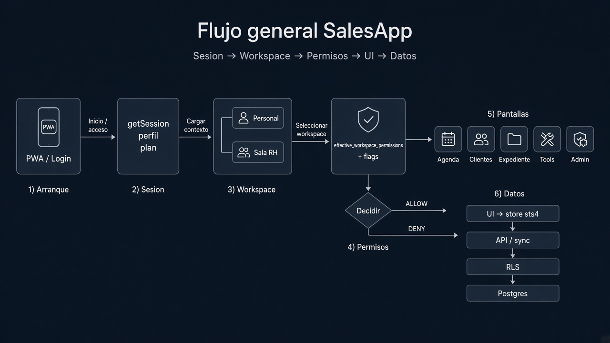

Versión vectorial (editable / zoom): [`flujo/00-vista-general.svg`](./flujo/00-vista-general.svg)

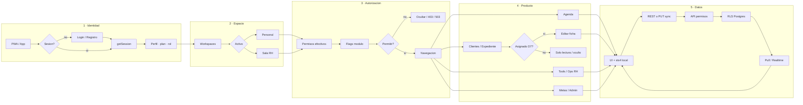

---

## 1. Arranque y sesión

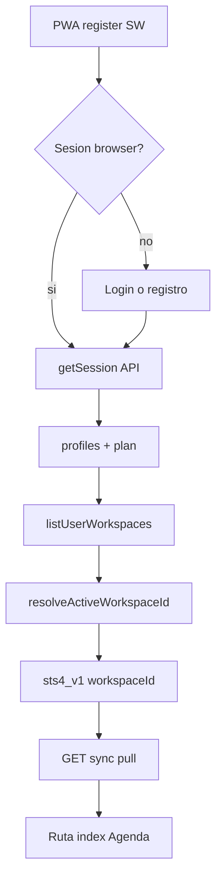


| Nodo | Evidencia |
|------|-----------|
| PWA / SW | `apps/web/src/modulos/auth/servicios/pwa-register.js` |
| Sesión browser | `apps/web/src/modulos/auth/servicios/supabase/ensure-browser-session.js` (`getSession` / refresh) |
| Login / registro | `apps/web/src/routes/index.jsx` rutas `/login` `/register` |
| `getSession` | `apps/api/src/modulos/auth/servicios/session-service.js` → `loadSession` |
| Perfil / plan | `loadSession` select `profiles` + `getCurrentMembership` |
| Workspaces | `workspaceService.listUserWorkspaces` / `resolveActiveWorkspaceId` (`session-service.js`) |
| Blob local | `apps/web/src/lib/storage/keys.ts` `sts4_v1` + `local-storage-adapter.ts` |
| Pull | `apps/web/src/modulos/sync/ui/sync-provider.jsx` + `hydrateProspectsFromApi` |
| Pantalla inicial | `routes/index.jsx` `index` → `CalendarPage` |

**Qué ve el usuario**

| Situación | Comportamiento (código) |
|-----------|-------------------------|
| Sin membresía de sala | Solo workspace(s) personal(es) en el rail; nav «Red»/«Mensajes» (`nav-config.js` `personalOnly`) |
| Una sala | Puede activarla (`switchWorkspace` / `session-service.js`); nav sala (`salaOnly`, compact RH si aplica) |
| Varias salas | Selector lista todos los WS del usuario; activo = `workspace_activo_id` o resolución de servicio. Multi-empresa: **nota** (fuera de alcance de estos diagramas) |

«Refresh token ya usado»: flujo de refresh en cliente Supabase (`ensure-browser-session.js`); mensaje exacto de GoTrue **sin confirmar** en UI propia.

---

## 2. Contexto de workspace por petición

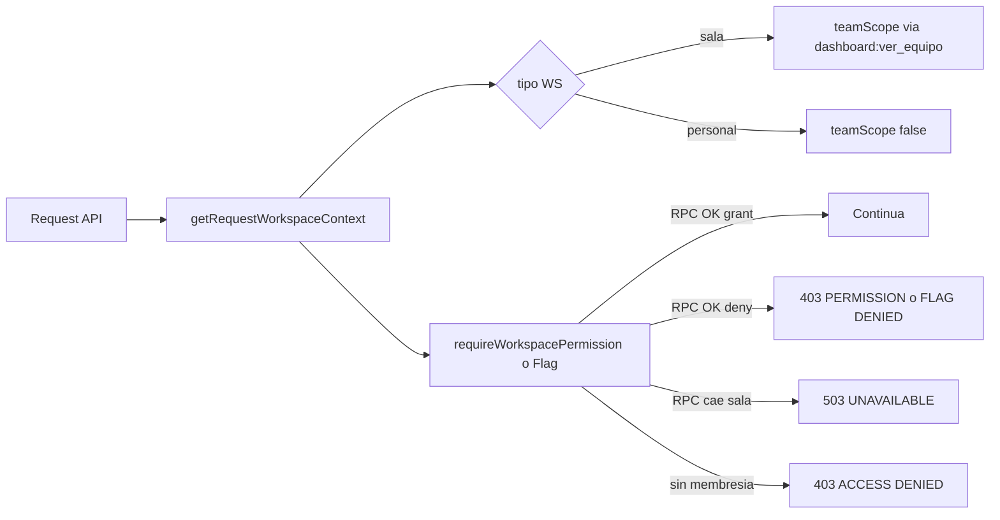


| Código | Cuándo | Evidencia |
|--------|--------|-----------|
| `teamScope` | Sala + `workspace_has_permission(..., dashboard:ver_equipo)` | `workspace-scope.js`: `getRequestWorkspaceContext` |
| `403 WORKSPACE_PERMISSION_DENIED` | Miembro sin clave | `workspace-permission-rpc.js`: `permissionDeniedError` |
| `403 WORKSPACE_ACCESS_DENIED` | Sin membresía / WS nulo | `workspaceAccessDeniedError` |
| `503 WORKSPACE_PERMISSIONS_UNAVAILABLE` | RPC permisos falla en **sala** (fail-closed) | `requireWorkspacePermission` |
| `403 WORKSPACE_FLAG_DENIED` / `503 WORKSPACE_FLAGS_UNAVAILABLE` | Flags módulo | `flagDeniedError` / `flagsUnavailableError` |

Personal: si el RPC de workspace falla, hay **fallback** a `resolve_user_permission_keys` / `resolver_flag` (no se usa como atajo en sala). Evidencia: `workspace-scope.js` `requireWorkspacePermission` / `requireWorkspaceFlag`.

---

## 3. Resolución de permisos

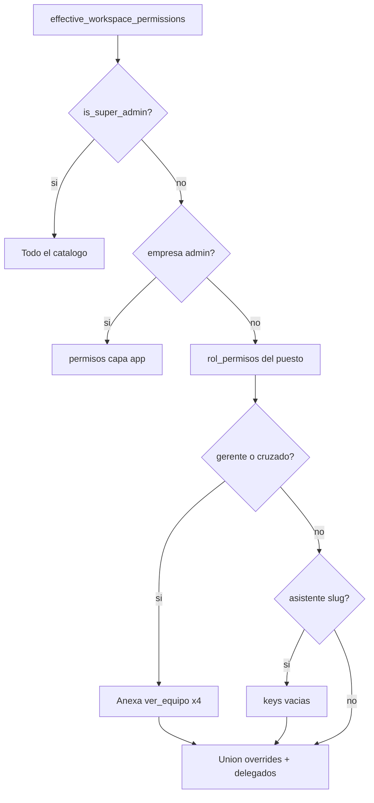


| Capa (orden SQL) | Evidencia |
|------------------|-----------|
| Superadmin → catálogo completo | `0090_empresa_admin_exclude_capa_admin.sql` `effective_workspace_permissions` |
| Admin empresa → solo `capa = 'app'` | mismo |
| `rol_permisos` (+ gerente/cross añade `*:ver_equipo`) | mismo |
| Asistente sala/empresa → base `{}` antes de union | mismo |
| Overrides workspace + `permisos_delegados` | mismo |
| Sesión sala | `resolveSalaSessionPermissionKeys` (`workspace-permission-rpc.js`) |
| Sesión personal (fallback) | `session-service.js` `resolveUserPermissions` / catch |

**Flags:** `resolver_workspace_flag` en sala; personal puede caer a `resolver_flag`. Comportamiento actual de falla en sala: **503 fail-closed**. Pendiente de producto (backlog): unificar fail-closed también donde aún hay fallback personal — ver hallazgos.

---

## 4. Navegación

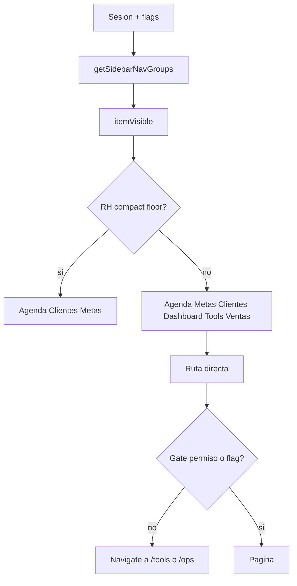


| Entrada | Condición de UI | Evidencia |
|---------|-----------------|-----------|
| Agenda `/` | Siempre en grupos base | `nav-config.js` `NAV_GROUPS` |
| Metas `/metas` | Base | mismo |
| Clientes `/clients` | Base | mismo |
| Mi equipo `/team` | `gerenteOnly` → `rol_en_workspace === gerente` | `itemVisible` + `use-app-nav.js` |
| Dashboard `/goals` | Base (oculto en compact RH) | `RH_COMPACT_NAV_HREFS` |
| Herramientas `/tools` | Base | mismo |
| Ventas `/sales` | feature `sales:history` | `itemVisible` + `hasUserFeature` |
| Red / Mensajes | `personalOnly` + cloud | `nav-config.js` |
| Chat equipo | `salaOnly` | mismo |
| Admin | `adminOnly` / `/api/v1/admin/me` | `use-app-nav.js` |
| Deep-link tool | `ToolPermissionGate` → `/tools` | `ToolPermissionGate.jsx` |
| Deep-link RH flag | `RhToolFlagGate` → `/tools` | `RhToolFlagGate.jsx` |
| Premanifiesto | `RhPremanifiestoGate` → `/ops/rh` | `RhPremanifiestoGate.jsx` |

Rutas: `apps/web/src/routes/index.jsx`.

---

## 5. Módulos (acción → regla → UI)

### 5.1 Clientes y expediente

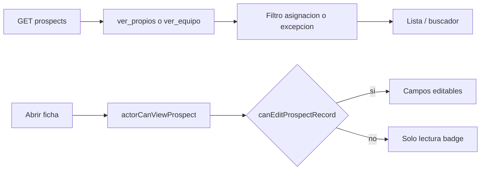


| Acción | Regla | Decisión | Evidencia |
|--------|-------|----------|-----------|
| Listar | `expedientes:ver_propios` o `ver_equipo` según `teamScope` + predicado asignación/excepción | Oculta ajenos no asignados | `prospectos-servicio.js` `listProspects` |
| Abrir | `actorCanViewProspect` | 404 si no | `getProspect` |
| Editar ficha | D7: dueño+`editar` ∨ **cualquier** `WORKFLOW_PERSON_COLUMNS` ∨ gerente/`workflow:revisar` ∨ `editar`+`ver_equipo` | RW / solo lectura | `acceso-edicion.js` `canEditProspectRecord` |
| Registrar venta | gerente ∨ `cerrador_id` ∨ `workflow:cerrar` | distinto de editar | `canRegisterProspectSale` |
| Participantes / badge `can_edit` | Solo `sala_de_venta` | 409 en personal | `prospect-participants-service.js` `loadAccess` |
| Compartir | `expedientes:compartir` + shares | UI red/share | catálogo + módulo compartir |
| Chat expediente | miembros sync workflow | sin confirmar todos los triggers UI | `sync_prospect_chat_members` (SQL histórico) |

### 5.2 Ventas, agenda, metas

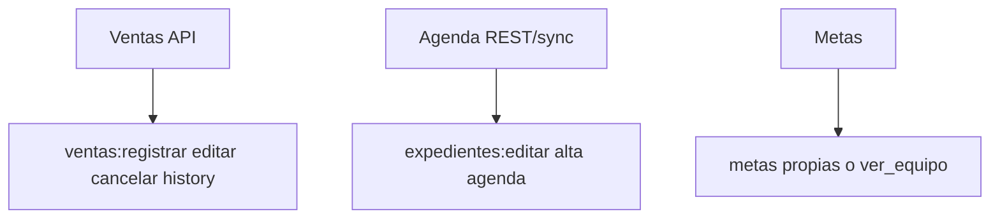


| Acción | Clave típica | Evidencia |
|--------|--------------|-----------|
| Registrar / editar / cancelar venta | `ventas:registrar` / `ventas:editar` / `ventas:cancelar` | módulo ventas API + `use-sale-features` |
| Historial | `sales:history` (feature) | `nav-config` + permisos usuario |
| Agenda alta/edición | `expedientes:editar` (REST y sync calendar) | entradas-agenda + sync permissions |
| Metas propias / equipo | `metas:ver_editar_propias` / `metas:ver_equipo` | seed + módulo metas |

### 5.3 Herramientas y ops RH

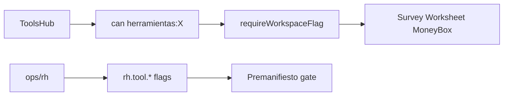


| Herramienta | Permiso UI | Flag / gate | Evidencia |
|-------------|------------|-------------|-----------|
| Survey / Vacaciones / Worksheet / Analysis | `herramientas:*` | `ToolPermissionGate` | `tool-permissions.js` |
| Configurar preguntas Survey | `herramientas:survey_configurar_preguntas` | sala + `can` | `can-configure-survey-questions.js` |
| Money Box | ruta sin `ToolPermissionGate` en hub | flag/paquete RH **sin confirmar** detalle fino | `routes/index.jsx` |
| Escritura tool en expediente ajeno | share `edit` o asignación workflow | `tools-service.js` `assertCanWriteAsOwner` |
| Premanifiesto / ops RH | flags `rh.tool.*` | `RhToolFlagGate` / `RhPremanifiestoGate` | `tool-flags.js` + routes |

### 5.4 Admin, equipo, notificaciones

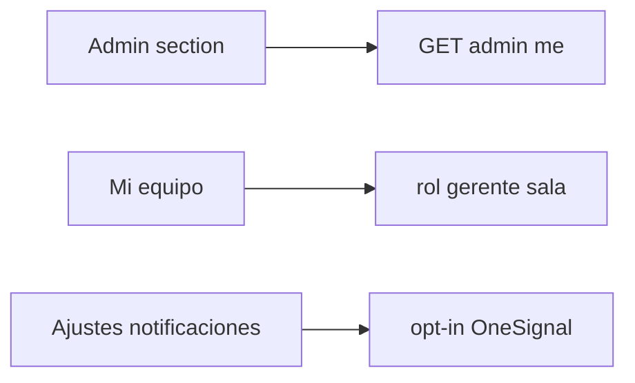


| Acción | Regla | Evidencia |
|--------|-------|-----------|
| Panel admin | `hasAnyAdminAccess` + `/api/v1/admin/me` | `use-app-nav.js` |
| Mi equipo | `gerenteOnly` | `nav-config.js` |
| Notificaciones push | SW + OneSignal opt-in | `onesignal.js` / `pwa-register.js` |
| Preferencias | UI Ajustes | `settings-page` + módulo notificaciones |

---

## 6. Lectura y escritura de datos

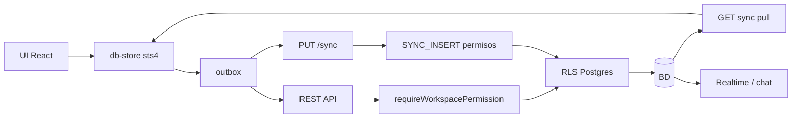


| Frontera | Rol | Evidencia |
|----------|-----|-----------|
| Cliente | UX / ocultar menú; **no** frontera de seguridad | `workspace-scope.js` comentario |
| API | `requireWorkspacePermission` / Flag + `canEdit*` | servicios |
| Sync | Permisos por tabla (`expedientes:editar`, etc.); ownership no se reescribe | `sync-service.js` / reconcile |
| RLS | SELECT/UPDATE prospects (0101/0104), tools, etc. | migraciones |
| Realtime | `user_can_access_prospect` (predicado asignación post-0101) | `0101_visibilidad_expedientes_asignacion.sql` |

**REST vs `/sync`:** misma familia de claves en muchos casos (p. ej. agenda `expedientes:editar`); sync además filtra ownership y teamScope en reconcile. Diferencias puntuales: ver tests `sync-reconcile` y backlog histórico.

---

## 7. Visibilidad de expedientes: actual vs objetivo

### 7.1 Estado actual (código + migraciones aplicadas)

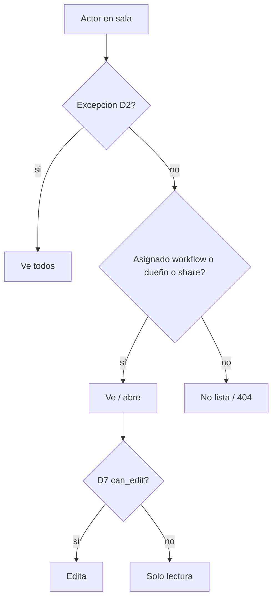


Etapas aplicadas (docs + código): **0101/0102** SELECT; sync filtrado + UI Etapas 2–3; **0103** strip `ver_equipo` seed; **0104** UPDATE + D7 edición por asignación.  
`teamScope` sigue existiendo como señal (`dashboard:ver_equipo`) pero **ya no** implica “ver todos” en lista/pull (predicado asignación/excepción).

### 7.2 Objetivo de producto (regla confirmada)

Coincide con el predicado actual para **ver**. Residuales documentados (no bloquean la regla base):

- Smoke sala roles Gerente/Asistente/Admin efímeros: GAP de seed sala.
- Share ficha `getProspect` vs share: gap histórico PASS* en matriz §6.4.
- Multi-sala / multi-empresa: fuera de alcance.

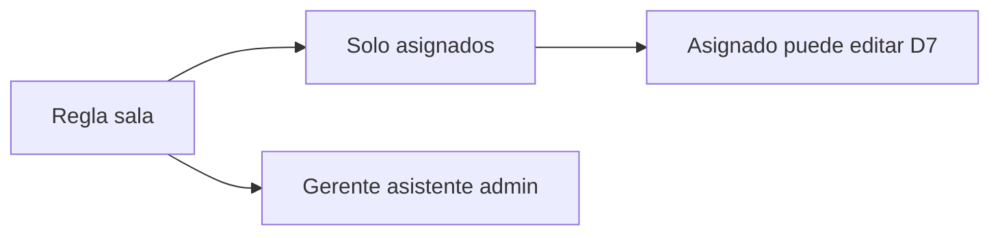


---

## Matriz rol × acción (Sala RH — derivada del código)

Leyenda: **P** permitido · **B** bloqueado · **R** solo lectura · **D** depende (asignación / flag / delegación).  
Fuente seed: `empresa-roles-seed.js` + `acceso-edicion.js` + nav.  
**No verificado** en RH real (prohibido mutar `workspace_miembros` de la sala de producción); celdas = **derivado del código**.

| Acción | Gerente | Liner | Cerrador | OPC / marketing | Asistente sala | Admin empresa | Superadmin | Miembro sin puesto |
|--------|---------|-------|----------|-----------------|----------------|---------------|------------|-------------------|
| Ver lista clientes | P `ver_equipo`+excepción | P propios/asignados | P propios/asignados | P propios/asignados | D delegados | P capa app | P | D rol plataforma |
| Abrir expediente propio | P | P | P | P | D | P | P | D |
| Abrir ajeno no asignado | P excepción | B | B | B | D | P | P | B |
| Editar expediente | P revisar/gerente | P si asignado **D7** | P si `cerrador_id` o collab D7 | P si asignado D7 | D | P | P | D |
| Asignar colaboradores | P manager | B | B | B | D | P | P | B |
| Registrar venta | P | B salvo `workflow:cerrar` | P si asignado/cerrar | B típico | D | P | P | B |
| Editar / cancelar venta | P claves ventas | D seed | D + cerrar | D | D | P | P | D |
| Nota / descanso agenda | P `expedientes:editar` | P seed liner | P | P | D | P | P | D |
| Worksheet RH | D flag+perm | D | D | D | D | P | P | D |
| Money Box | D | D | D | D | D | P | P | D |
| Survey | D `herramientas:survey` | D | D | D | D | P | P | D |
| Configurar preguntas Survey | D clave específica | B típico | B | B | D | P | P | B |
| Premanifiesto | D flags hijos | D | D | D marketing/opc | D | P | P | D |
| Metas equipo | P `metas:ver_equipo` | B seed | B | B | D | P | P | B |
| Admin miembros/roles | D admin | B | B | B | B | P | P | B |
| Compartir expediente | D `expedientes:compartir` | D | D | D | D | P | P | D |
| `dashboard:ver_equipo` | P seed | B post-0103 | B | B | B | P | P | B |
| `workflow:revisar` | P | B | B | B | D | P | P | B |
| `workflow:cerrar` | P | B | P | B | D | P | P | B |

---

## Verificación empírica

| Prueba | Resultado |
|--------|-----------|
| Smoke personal D7 PATCH (`smoke-d7-edit-personal-qa.mjs`) | Asignado `liner_id`/`opc_id` → PATCH 200; sin asignación → 404; participants personal → 409 | **Verificado** (QA efímera + purge) |
| Matriz puestos dentro de Sala RH | No ejecutada: mutar miembros/puestos de la sala real está prohibido en helpers | **Derivado del código** |
| Smoke sala con `QA_SALA_WORKSPACE_ID` | GAP: no hay Sala QA P0 en prod al documentar | **sin confirmar empírico** |

Detalle operativo (emails temporales, reportes): solo en apéndice privado local (no repo).

---

## Hallazgos (sin corregir aquí)

1. **`/participants` exige sala** (`loadAccess` → 409 en personal): el badge `can_edit` de UI sala no aplica en WS personal aunque el PATCH D7 sí.
2. **`teamScope` sigue atado a `dashboard:ver_equipo`**, pero lista/sync **ya no** interpretan eso como “ver todos” (0101); fácil confundir con docs antiguos.
3. **Docs previos §1.1** decían que collab no editaba; **código D7** (2026-11-11) sí — esta página alinea a código.
4. **Fallback `resolver_flag` / permisos globales en personal** cuando falla RPC: sala es fail-closed; personal no — backlog de hardening.
5. **Money Box** en rutas sin el mismo `ToolPermissionGate` que Survey/Worksheet; `RhToolFlagGate` trata flag ausente del catálogo (`null`) como **fail-open**.
6. **REST PATCH vs RLS D7:** `updateProspect` exige siempre `expedientes:editar` antes de `canEditProspectRecord`; RLS `0104` permite UPDATE por sola asignación — REST más estricto que BD para asignados sin esa clave.
7. **Catálogo vs código:** en `permission-catalog` aparecen sin uso claro en `apps/` p. ej. `agenda:usar`, `dashboard:ver_propio`, `notificaciones:configurar_propias`, `mensajes:usar`, `red:usar`. Al revés, `workflow:*` y `gestionar_empresas` se usan en API/RLS/admin **fuera** del catálogo shared.
8. **Superadmin sesión vs SQL:** `session-service` exige `is_super_admin && role === "admin"`; RPC `effective_workspace_permissions` solo mira `is_super_admin` — posible divergencia UI/API.
9. **`getRequestWorkspaceContext` no lanza `WORKSPACE_*`:** ante error devuelve workspace nulo; los 403/503 salen de `requireWorkspacePermission` / Flag / RPC (`workspace-permission-rpc.js`).
10. **Clave local `sts4_user_v1`** (no `sts4_user`); docs/ejemplos antiguos a veces citan el nombre corto.

---

## Índice de diagramas

| Archivo | Contenido |
|---------|-----------|
| [`flujo/00-vista-general.jpg`](./flujo/00-vista-general.jpg) / [`.svg`](./flujo/00-vista-general.svg) | **Vista general** (un solo diagrama) |
| [`flujo/01-arranque.svg`](./flujo/01-arranque.svg) | Arranque y sesión |
| [`flujo/02-contexto-workspace.svg`](./flujo/02-contexto-workspace.svg) | Contexto API / errores |
| [`flujo/03-permisos.svg`](./flujo/03-permisos.svg) | Capas `effective_workspace_permissions` |
| [`flujo/04-navegacion.svg`](./fluxo/04-navegacion.svg) | Menú y deep-links |
| [`flujo/05-clientes-expediente.svg`](./flujo/05-clientes-expediente.svg) | Clientes / edición D7 |
| [`flujo/06-ventas-agenda-metas.svg`](./flujo/06-ventas-agenda-metas.svg) | Ventas / agenda / metas |
| [`flujo/07-herramientas-rh.svg`](./flujo/07-herramientas-rh.svg) | Tools y ops RH |
| [`flujo/08-admin-equipo-notif.svg`](./flujo/08-admin-equipo-notif.svg) | Admin / equipo / notif |
| [`flujo/09-datos.svg`](./flujo/09-datos.svg) | Path datos y fronteras |
| [`flujo/10-visibilidad-actual.svg`](./flujo/10-visibilidad-actual.svg) | Visibilidad hoy |
| [`flujo/11-visibilidad-objetivo.svg`](./flujo/11-visibilidad-objetivo.svg) | Regla objetivo |

**Nota multi-sala / multi-empresa:** el modelo de datos admite varias salas y empresas; estos diagramas no cubren conmutación cross-empresa ni gerentes con `gerente_acceso_cruzado` más allá de la capa de permisos citada.
